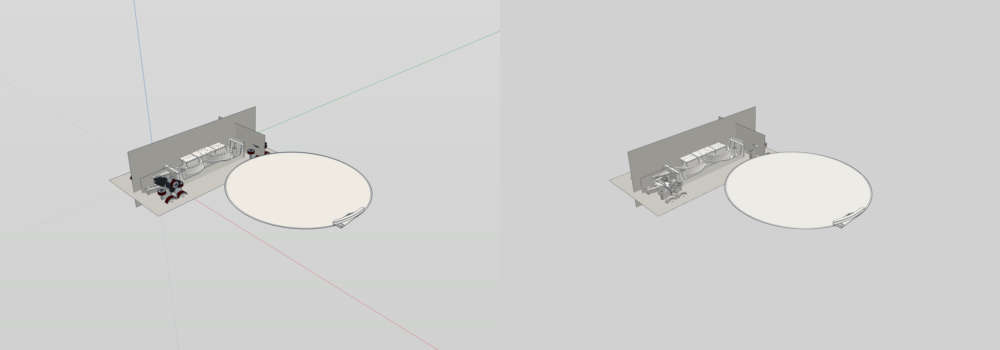
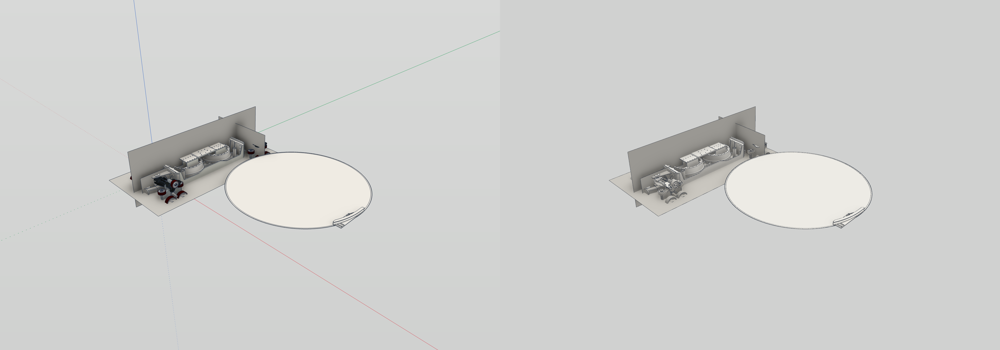
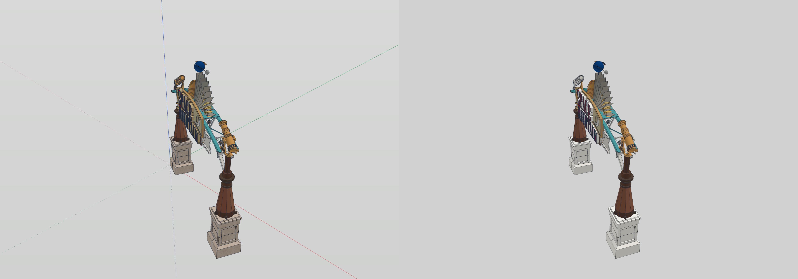
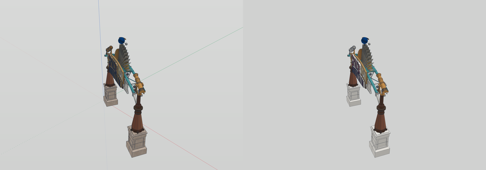
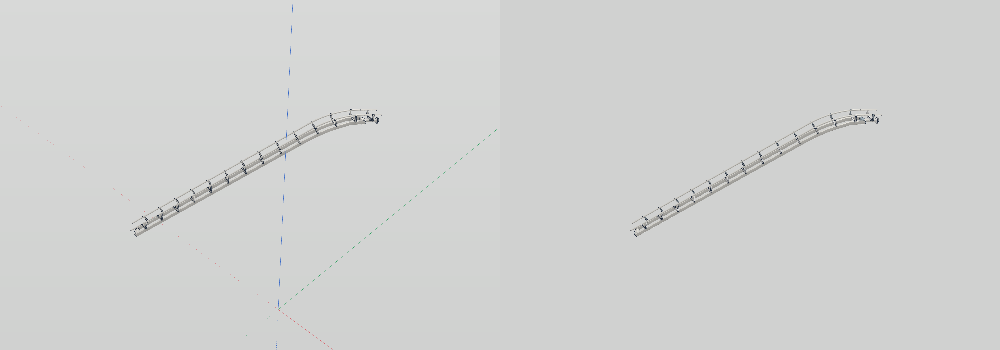

## Pixel differences at 2× HiDPI

RGB mean absolute error in 8-bit levels (0–255). Delta error compares each renderer’s AO-on minus AO-off image; base material/background differences mostly cancel.

| Model | GL/Metal off MAE | GL/Metal on MAE | AO delta MAE |
|---|---:|---:|---:|
| pusher_car_rust | 4.1298 | 4.4725 | 0.4579 |
| marquee | 4.8981 | 5.0381 | 0.2050 |
| space_asbuilt_ride-section | 3.9886 | 3.9977 | 0.0236 |

## Comparison images

### pusher_car_rust

### marquee

### space_asbuilt_ride-section

