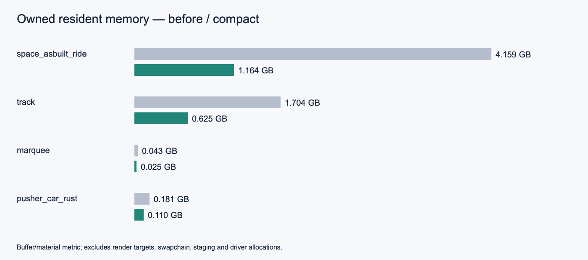

# Performance plan — native-modeller fluidity

*Written 2026-08-25, after the piscina.igz marathon. Owner benchmark
(Marco): "the reference native modeller feels ~2× smoother overall" on the same laptop
(Radeon 780M, Wayland). Goal: close that gap on real project scenes
(200–400k faces) — not on synthetic million-face torture tests.*

## The scoreboard (baseline, measured 2026-08-25)

| Metric | Today | Target |
|---|---|---|
| Paint, clean piscina (283k faces) | 4–22 ms | ≤ 16 ms sustained (60 fps) |
| Paint, 5 hedges (1.2M faces) | 37–40 ms | ≤ 20 ms (instancing + culling) |
| Hover latency (pick+snap, big model) | 25–40 ms | ≤ 10 ms |
| Wheel-zoom gesture start (re-pick) | 25 ms | ≤ 5 ms |
| Cold start to first full paint | ~11 s | ≤ 2 s perceived (progressive) |
| Tile upload hitch during zoom | ~100 ms | none ≥ 33 ms |
| Idle CPU | 0 % ✓ | 0 % (keep watching the 149 % ghost) |

`INGETRAZO_PERF=1` is the measuring stick; every phase lands with its
numbers in the commit message, like the marathon did.

## Why the native modeller feels 2× (honest diagnosis)

1. **Input→photon latency, not raw fps.** Our paints already hit 60 fps
   on clean scenes. What a native modeller does better is the path from gesture
   to frame: their event handling, picking and snapping are native; ours
   cross Python on every mouse move (25–40 ms of hover work before the
   paint even starts). Latency, not throughput, is most of the "2×".
2. **They draw less.** No frustum culling here yet: every chunk is
   submitted every frame even when the camera is inside the house.
3. **Fixed per-frame overhead**: the FBO+blit (forced by the Wayland
   depth bug) plus the QPainter overlay pass cost a few ms that native
   apps don't pay.
4. **Instance geometry is world-baked**: 5 instances of a 230k-face
   hedge = 5× vertex data uploaded and drawn. A native modeller draws one
   definition N times.

## Principles

- **Measure first.** No optimization lands without a before/after from
  the perf log. Phase 0 exists so we stop guessing.
- **Draw less before drawing faster.** Culling and instancing beat any
  library swap.
- **Native code only where the profiler demands it,** as leaf kernels
  behind a stable NumPy-shaped interface — never a rewrite.
- **The Python core is the moat, not the bottleneck to remove.** The
  velocity of this project (solo dev + AI pair) exists BECAUSE the app
  is Python. We keep it.

## Phases

### P0 — Frame telemetry (the microscope) — DONE 2026-08-25 (`4a9de47`)
GL timer queries + per-pass timings (faces / edges / silhouettes /
overlay / blit) and an input-to-paint latency stamp, behind a perf HUD
toggle. The perf log gains `frame gl=..ms ovl=..ms py=..ms lat=..ms`.
*Gate: we can name the top 3 costs of any janky frame in one look.*

### P1 — Frustum culling per chunk (draw less) — DONE 2026-08-25 (`4a9de47`)
Every chunk/instance already has (or can cheaply cache) a bbox; cull
against the view frustum before submitting, vectorized over all bboxes
at once (one NumPy pass, ~µs for hundreds of chunks). Also cull the
pick index the same way for hover rays.
*Gate: camera inside the casita → paint cost drops to the visible
subset; orbiting a corner of a big scene never submits the far side.*

### P2 — GPU instancing for components (the hedge killer) — slice 1 LANDED 2026-08-25 (instanced draw all modes + sections; validated live with 5 copies. Remaining: drop baked per-instance pick arrays via ray transform)
Replace world-baked instance chunks with ONE proto VBO + per-instance
matrices via `glDrawArraysInstanced` + `glVertexAttribDivisor`
(GL 3.3 core ✓). Wins: N hedges cost 1× vertex memory and 1 draw; the
instance chunk build (7.3 s cold for 230k) happens once per PROTO;
Move/Rotate of instances updates a 64-byte matrix, not arrays.
*Gate: 5 hedges paint ≈ 1 hedge + ε; cold start no longer rebuilds
per-instance.*

### P3 — Input latency (the feel) — core LANDED 2026-08-25 (ray-pick chunk prefilter: model 41→1.8 ms, sky 34→0.03 ms; budgeted-hover gate shrinks with it. Deferred: FBO depth-readback for the wheel (superseded — pick is ≤2 ms now), overlay dirty-flag)
- Budgeted hover: hard 10 ms budget — pick against the P1-culled index,
  defer the expensive snap refinements to the trailing-edge timer.
- Wheel focus: depth-readback under the cursor (1 px from the existing
  FBO) instead of the 25 ms CPU ray-pick on gesture start.
- Overlay pass on a dirty flag (skip QPainter entirely on pure camera
  frames with no labels in view).
*Gate: hover ≤ 10 ms on piscina; zoom gesture start indistinguishable
from mid-burst.*

### P4 — Async the stalls — LANDED 2026-08-25 (disk chunk cache: hedge 8.5→0.47 s, scene chunks ~7-8→~1.5 s warm; tile uploads paced 6→2/frame. Remaining: the .igz parse itself (~8 s) is now the cold-open floor)
- Tile/texture uploads staged through PBOs or split across frames
  (≤ 2 ms of upload per frame) — kills the 100 ms zoom hitch.
- Progressive cold start: paint what is chunked, build remaining group
  chunks in a background pass between frames (NumPy releases the GIL
  for the heavy slices) — the app is interactive in ~2 s, the hedge
  pops in when ready.
*Gate: no frame ≥ 33 ms during tile churn; time-to-interactive ≤ 2 s.*

### P5 — Native leaf kernels (only where P0 still complains)
Ranked candidates, each a drop-in behind an existing function:
1. **Triangulation**: swap `core/triangulate.py`'s Python earcut port
   for the official C++ `mapbox_earcut` wheel (pip, all platforms, no
   toolchain) — keep ours as fallback and for the hole-splitting
   preprocessing. Cheapest native win available.
2. **Ray/pick BVH**: a small Rust (PyO3/maturin) or pybind11 module for
   triangle BVH build + query. Only if P1+P3 leave picking on top.
3. **Weld/topology bulk ops**: same criterion.
Watch-list, not plan: free-threaded Python 3.14 (chunk builds across
cores once PySide6 supports it cleanly), Qt RHI.

## What we deliberately do NOT do

- **No C++/Rust rewrite of the app or the engine.** Death by rewrite is
  how solo projects end; the leaf-kernel path gets 80 % of the benefit.
- **No renderer/library swap** (VTK, Qt Quick 3D, ModernGL, wgpu,
  game engines): our draw-call count is already low — the overhead they
  would remove is not where the time goes, and each drags its own
  interaction model that fights the push/pull feel.
- **No LOD/impostor system yet**: culling + instancing must land first;
  billboard impostors for distant vegetation are a later, separate
  conversation (the usual push/pull modellers don't have them either — it
  would be a leapfrog, not parity).

## First P0 findings (2026-08-25, live piscina session)

Slow frames (25–29 ms) are dominated by the **edges pass** (19–22 ms:
271k-face wireframe lines + silhouettes) — a P3-adjacent target.
Gesture latency measured at 30–70 ms. Culling live: 12–25k tris
dropped while orbiting; paints 5–12 ms.

## Order and sizing

P0 is half a session. P1 and P3 are a session each and pay the most
"feel" per line. P2 is the big one (touches chunks, picks, move/rotate
paths) — a full session with the regression suite as the net. P4 rides
wherever the telemetry points. P5 only on evidence.

## P6 — array geometry for takeoff and export (2026-11-08)

`core.geometry_arrays` reads deferred Plans directly and caches built-mesh
extraction by mutation serial. Owned placements exclude tagged descendants and
opening groups. Their world positions are welded before ring-edge occurrence
counting, so separately placed open pieces can form one watertight object.
Newell vectors measure gross/net area and anchored float64 volume; hole winding
is normalized for the volume sum to match triangulation's treatment of holes.

Takeoff, class quantities, CSV, the BIM tray, spatial bodies and openings now
consume arrays. Face tags inside group definitions also stay deferred, including
persistent IFC identity updates. Only legacy scene-level loose-face objects
retain the face-based quantity path. Existing explicit face consumers are
unchanged. IFC material weighting reads face metadata in face order without
constructing faces. The default remains BRep; an export profile can select
`"geometry": "polygonal"` for IFC4 or IFC4X3_ADD2. Polygonal bodies contain one
point list and face set, with indexed faces and indexed faces with voids.

Reproduce with Python 3.13, NumPy 2.5.4, PySide6 6.11.3 and ifcopenshell
0.9.0.post1, without the Rust wheel:

```sh
QT_QPA_PLATFORM=offscreen .venv-work/bin/python scripts/benchmark_array_geometry.py \
  /Users/legallmaxence/Desktop/space_exact/space_asbuilt_ride.igz \
  --output .array-benchmark
```

The input is read-only; outputs go to the worktree. The run found 1,482 tagged
objects and retained all 15,906 deferred group meshes after each export. Baseline
numbers below are the supplied earlier measurements, not a rerun that would
materialize the entire model. The new run overlapped the bounded test suite;
wall times are subject to contention (cold runs ranged from 45.9 to 86.0 s).

| Operation | Earlier Python-face path | Arrays |
| --- | ---: | ---: |
| Load | approximately 10–16 s | 14.95 s |
| Cold takeoff | 951 s | 85.97 s |
| Warm takeoff, no memo | — | 54.82 s |
| Unchanged-scene memo takeoff | — | 0.54 s |
| BRep export (including takeoff) | 781 s | 153.61 s |
| BRep file | approximately 1.37 GB | 1,367,097,328 bytes |
| Polygonal export (including takeoff) | — | 109.79 s |
| Polygonal file | — | 654,530,304 bytes |

BRep is 5.1× faster than the supplied baseline; polygonal export is 7.1× faster
and produces a file 52.1% smaller than the new BRep. Process peak RSS was
1,954,168,832 bytes after warm takeoff and 11,783,258,112 bytes after BRep.
The two exports share a process, so its polygonal-stage RSS high-water mark
still includes the preceding BRep. BRep's in-memory STEP lines and final text
remain a substantial allocation; this change does not introduce a streaming
STEP writer. `--geometry polygonal` measures that profile in isolation.

A separate fresh process using the same command with `--geometry polygonal`
measured a **5,325,602,816-byte peak RSS**, 110.77 s export time and the identical
654,530,304-byte output. In that run, cold/warm/memo takeoff took
45.87 / 32.93 / 0.30 s, with 3,462,086,656-byte peak RSS before export.
All deferred group meshes remained deferred in both runs.

Cold and non-memoized takeoff remain above five seconds, so
`LIVE_TAKEOFF_LIMIT` stays at 2,000. The array path removes Python geometry
allocation, but NumPy planning, welding, and edge counting are still significant.

Twenty small tagged leaf objects from the ride were compared with the old
Python path (at most 100 faces each). Areas, net areas and volumes agreed within
2e-5 relative / 1e-7 absolute tolerance; maximum observed relative error was
1.805725e-6. Bit-for-bit equality is not promised: Qt's float32 geometry and
NumPy's float64 reductions round differently. Regression cases also cover
holes with either winding, nested transforms, large-coordinate anchored volume,
a closed shell split across placements, open sheets, tagged/excluded children,
cache invalidation, loose-face compatibility, deferred face tags and GUID
persistence, deferred material weighting, and IFC4/IFC4X3_ADD2 readback with
EXPRESS-rule validation for both geometry profiles.

Final focused validation:

```sh
QT_QPA_PLATFORM=offscreen .venv-work/bin/python -m pytest \
  tests/test_geometry_arrays.py tests/test_bim.py \
  tests/test_bim_grouped_tags.py tests/test_bim_reinforcing_bar.py \
  tests/test_ifc_export.py tests/test_ifc_records_export.py \
  tests/test_ifc_vocabulary_relationships.py -q
```

Result: **72 passed, 2 skipped** (30.03 s). The standalone array test file has
17 passing tests, including schema/profile/closure parameter combinations.
The required bounded suite command is:

```sh
QT_QPA_PLATFORM=offscreen .venv-work/bin/python scripts/pytest_batches.py -m 'not slow'
```

Bounded-suite result: **22 failed, 6,917 passed, 303 skipped, 2 xfailed,
805 deselected, 56 warnings in 1,488 s** (six batches, run once).
Nineteen failures match the supplied baseline: 14 translation cases (including
Arabic), cursor picking, extension wrapping, hidden-panel lifetime, swatch tooltip,
and toolbar bold text. Three additional first-batch failures were in
`test_ifc_vocabulary_relationships.py` (both relationship round trips and the child
opening/material fallback). They exposed a local `quantities` name collision in
`save_ifc`; the array quantity import is now aliased. The affected file then
passed all 16 tests, and the final combined focused run passed 72 tests with two
skips. The bounded run was not repeated after that fix; no new failure remains
unaddressed. Local logs are `.bounded-suite.log`, `.validation-final.log`,
`.benchmark-final.log`, `.benchmark-polygonal.log` and `.sample-quantities.log`.
Generated large IFC files were removed after measurement.

## Perf 2 — ride viewport telemetry (2026-11-08, partial implementation)

The instanced face/edge passes now report submitted prototype batches and
placements, strict-view frustum and subpixel rejects, logical edit-context
batches, actual draw calls (including retained native tape replay), gather
milliseconds, CPU assembly/remainder milliseconds and CPU GL submission
milliseconds. `face_draws` and `edge_draws` separate the two passes. The once-per-
second summary includes the last frame's counters, even for fast frames.
Recording a deferred tape does not count a draw; executing or replaying it does.
The existing guard-band superset can submit placements counted as strict-view
rejects. These are deliberately different counters, not an accounting identity.

`inst_gl_submit` is CPU wall time inside command submission, **not GPU elapsed
query time**. Driver stalls are included. On the general non-tape path it times
draw calls; on the tape path it includes recorded state calls too. `inst_python`
is the instanced pass time less measured submission, so includes uploads,
untimed GL state work and gathering. It must not be interpreted as a Python
profiler's exclusive instruction time. `inst_vbo` counts allocated prototype
vertex/normal/edge/texture/back buffers and matrix buffers, counting shared
mirror geometry once. It excludes textures, framebuffers, consolidated buffers,
VAOs, driver overhead and all host copies; it is a lower bound, not total VRAM.

Measurement uses Python 3.13 and a release Rust build in `.venv-work`. Local
`.perf-runtime/run.py` bounds every GUI child to 240 seconds (the first diagnostic
was 150 seconds). QSettings, writable Qt data, crash logs and drawing/texture
caches are redirected into the worktree. The input document is read only.
The first main-window diagnostic did not reach model paint before its deadline:
stack samples showed eager `prepare_drawing`, geometry prefetch, cache JSON
serialization, and smooth-stream baking. This is separate from `paintGL`.

A real, isolated QOpenGLWidget benchmark loads the same document, restores its
stored camera and bypasses main-window eager preparation/trays. Its first run
loaded in 7.82 s and reported:

```text
frame 88660ms ground=1ms sync=70877ms shadowmap=0ms faces=17254ms edges=515ms cull=0k/0k tris +0k edges
```

The supplied earlier observation was first paint 20.9 s (faces 17.7 s, sync
2.9 s); this run agrees on faces but has much slower cold sync. The bounded
regression suite ran concurrently, so these are contention-affected observations,
not an isolated hardware ceiling measurement. There are 21 root groups; the
91k group count includes their nested placements.

Implementation status: telemetry is the only implemented deliverable in this
section. Progressive bake/upload scheduling, pending bounding-box rendering,
eager/background pick preparation, a hybrid consolidation policy, and its edge
pass counterpart remain unimplemented. No <2 s first-paint, <100 ms hover, or
<100 ms orbit gate is claimed. The scheduler/split regression tests are also still outstanding; a new
camera-reuse regression verifies the existing pick cache contract (below). A renderer migration decision cannot be based
on this partial work: cached native command replay already exists, but the
first-frame eligibility checks and placement bounds still demand prototype
bakes synchronously, and native replay alone does not reduce draw-call count.
A safe progressive change must address those upstream dependencies as well as
uploads, with consistent handling of transparency, mirrored placements, edits,
picking and cache invalidation.

Telemetry-enabled, default-navigation samples (`.perf-after-orbit.log`):

```text
frame 35219ms ... sync=17433ms faces=17329ms edges=453ms ... inst_proto=10040 inst_place=61766 inst_frustum=26117 inst_pixel=2909 inst_batches=10040 inst_draws=19787 face_draws=9987 edge_draws=9800 gather=14310.0ms inst_python=17403.5ms inst_gl_submit=371.8ms inst_vbo=758.1MiB
frame 33ms ... faces=31ms edges=1ms ... inst_proto=11448 inst_place=65995 inst_frustum=24355 inst_pixel=3135 inst_batches=11448 inst_draws=11395 face_draws=11395 edge_draws=0 gather=4.9ms inst_python=5.2ms inst_gl_submit=25.2ms inst_vbo=814.2MiB
frame 1868ms ... faces=1857ms edges=1ms ... inst_proto=11557 inst_place=66312 inst_frustum=24259 inst_pixel=3108 inst_batches=11557 inst_draws=11504 face_draws=11504 edge_draws=0 gather=1525.6ms inst_python=1787.6ms inst_gl_submit=69.3ms inst_vbo=821.4MiB
```

The first sample shows startup assembly rather than GL submission dominating.
The latter two distinguish a reused tape from a changed-visible-set spike.
They also expose an existing behaviour: `_navigation_detail` suppresses edges
while navigating dense assemblies. A 33 ms faces-only frame is **not** evidence
for the requested faces-plus-edges gate. Full-detail diagnostic runs override
that method to return False in the benchmark wrapper only. No rendering policy
was changed in the implementation. Cold sync timing varied markedly as caches
warmed; no speedup is attributed to this instrumentation-only patch.

Focused validation after the telemetry edits:

```sh
QT_QPA_PLATFORM=offscreen .venv-work/bin/python -m pytest -q \
  tests/test_instanced_telemetry.py tests/test_instanced_gather_pool.py \
  tests/test_instanced_view_superset.py tests/test_identical_prototype_batches.py \
  tests/test_ambient_occlusion.py tests/test_nested_group_edit.py
```

Result: **45 passed, 8 skipped, 2 warnings in 10.83 s**. The new telemetry file
has four tests, covering deferred/immediate/native/merged submission counting
and disjoint strict-view rejection counts on a reused gather result. Existing
offscreen GL-dependent cases remain skipped; the live benchmark supplies GL
execution evidence. Log: `.telemetry-final.log`.

The requested camera-reuse regression now verifies an existing property:
changing yaw, pitch and perspective preserves the lazy bounds table, loose pick
index and Rust InstanceSet by identity. Moving a placement then invalidates
all three. This is not background preparation and does not establish ride-model
hover latency. The repeated context cost still needs a cursor-specific profile;
assuming every camera change rebuilds the whole scene index would be incorrect.

```sh
INGETRAZO_RUST=1 QT_QPA_PLATFORM=offscreen .venv-work/bin/python -m pytest -q \
  tests/test_lazy_native_snap.py::test_camera_changes_reuse_pick_geometry_until_a_placement_moves
```

Result: **1 passed in 1.12 s** (`.pick-reuse-test.log`).

Full-detail before/after (navigation edge suppression disabled **in the local
benchmark only**, no product setting changed):

```text
before: frame 35868ms ... sync=18261ms faces=17121ms edges=476ms cull=0k/0k tris +0k edges
before orbit: frame 443ms ... faces=135ms edges=302ms cull=0k/0k tris +0k edges
 after: frame 38621ms ... sync=19850ms faces=18309ms edges=458ms ... inst_proto=10040 inst_place=61766 inst_frustum=26117 inst_pixel=2909 inst_batches=10040 inst_draws=19787 face_draws=9987 edge_draws=9800 gather=15036.4ms inst_python=18332.5ms inst_gl_submit=428.4ms inst_vbo=758.1MiB
 after orbit: frame 260ms ... faces=151ms edges=105ms ... inst_proto=11250 inst_place=65745 inst_frustum=24525 inst_pixel=3132 inst_batches=11250 inst_draws=22200 face_draws=11198 edge_draws=11002 gather=19.4ms inst_python=20.0ms inst_gl_submit=231.0ms inst_vbo=806.6MiB
 after spike: frame 5413ms ... faces=4614ms edges=785ms ... inst_proto=11950 inst_place=67138 inst_frustum=22025 inst_pixel=3080 inst_batches=11950 inst_draws=23577 face_draws=11896 edge_draws=11681 gather=1993.4ms inst_python=4657.1ms inst_gl_submit=735.9ms inst_vbo=830.2MiB
```

Before: 21 logged orbit samples, median 295 ms, range 56–5,720 ms. With telemetry:
48 logged orbit samples, median 293.5 ms, range 46–5,413 ms. These unequal, short
runs with concurrent tests and cache warming are diagnostics, not a speedup
claim. `frame` logs omit frames below 25 ms; medians describe logged samples,
not an unbiased complete frame distribution. Logs are `.perf-before-detail.log`
and `.perf-after-detail.log`; the local runner/wrapper, stack samples and
`.perf-runtime/results.json` retain the reproduction details. Every GUI child
has exited. The maximum measured prototype VBO lower bound was **830.2 MiB**;
no hybrid memory estimate exists because no hybrid path was implemented.

Assessment: this implementation has not demonstrated any of the three latency gates. At full
detail the current renderer sends roughly 20–24k instanced calls per sampled
frame. Even native replay spends hundreds of milliseconds in submission on
some frames; changing visibility can also trigger seconds of gather/recording.
Moving the same Python loop into Rust alone cannot remove those draw calls.
The next experiment should collapse small prototypes with a bounded memory
budget and preserve chunk culling, then measure again. These observations do
not establish GL 3.3's post-consolidation ceiling and do not justify claiming
that wgpu is either necessary or unnecessary. A decision to migrate now would
be based on the current batching architecture, not on a tested GL 3.3 limit.

Bounded suite (run once):

```sh
QT_QPA_PLATFORM=offscreen .venv-work/bin/python scripts/pytest_batches.py -m 'not slow'
```

Result: **22 failed, 7,083 passed, 138 skipped, 2 xfailed, 805 deselected,
56 warnings in 1,398 s (six batches)**, recorded in `.bounded-suite.log`.
Nineteen failures match the supplied baseline: 14 translations (including ar),
cursor pick, extension wrapping, hidden-panel lifetime, swatch tooltip and
bold toolbar tooltip. The additional three are source-inspection tests in
`test_nested_group_edit.py`: the process imported the viewport before it was
edited, then `inspect.getsource` read shifted source lines from the edited file.
All three passed in the final fresh-process focused run above (which includes
all 24 tests in that file). No additional unresolved regression was observed.
The bounded suite was not repeated on the final snapshot; the new telemetry
file and camera-reuse case were added after their batch collection and were
validated separately by the exact focused commands above.

Generated drawing/texture caches (~3.3 GiB) were removed after measurement;
benchmark scripts, logs, stack samples and the baseline source snapshot remain
locally under the worktree. Nothing was pushed, and no PR or issue was created.

## P7 — wgpu renderer spike (2026-11-08)

A separate pyo3 `ingetrazo_render.Renderer` now uploads a resident scene,
computes per-placement frustum/one-physical-pixel culling on the GPU, compacts
survivors into bounded per-prototype ranges, and renders indexed indirect
commands. The production GL viewport is unchanged when `INGETRAZO_WGPU` is
unset. Build/run/API details: [renderer README](../rust/ingetrazo_render/README.md).

### Method and coverage

Apple M1 Max, Metal, macOS 27.2 (26B123), Rust 1.90, Python 3.13.12,
PySide6 6.11.3, NumPy 2.5.4, wgpu 24.0.5. Bare 1000×700 logical window;
viewport 1000×673 at 2× (2000×1346 physical). Single-sample depth and integer
ID target, sRGB presentation; MSAA and edges deliberately omitted. Full-circle
orbit over ten seconds, framed to visible bounds. Test processes were suspended
during measurements. These are repeat runs with warm filesystem caches, not a
controlled cold-cache experiment. Earlier load observations varied from 8.1 to
34.1 seconds for ride; track consistently took about 24 seconds.

CPU is acquire/encode/submit/present time, excluding timestamp-map wait.
GPU timestamps span culling through raster, including intervening scheduling.
Wall time includes camera update, Python/Rust crossing and synchronous timestamp
readback. The render method waits every frame for measurement; there is no
production asynchronous timestamp ring yet. Qt timer/event-loop gaps are not
included in individual wall frame samples; total frames are also reported.
Setup/upload includes adapter, device, pipelines and resident upload together;
it is an upper bound for upload alone. First picture is the first rendered
frame after show/processEvents, not an input-to-photon measurement.

**Input discrepancy:** the supplied path currently contains a 141,384,561-byte
archive, not the brief’s 736 MB file. SHA-256 fingerprints of both measured
inputs are recorded in [inputs.json](benchmarks/wgpu-2026-11-08/inputs.json).
The brief also says 86,757 own placements.
A separate read-only inventory of the exact supplied file at this base commit
finds 91,211 groups, 19,013 distinct mesh objects, 3,107 empty mesh objects,
15,906 deferred nonempty prototypes, and **76,029 placements with positions**
(the same count have edges; 70,374 have raw faces). The renderer retains all
76,029 geometric placements, including hidden and edge-only ones; 69,116 are
visible by scene flags before camera culling. Empty containers do not acquire
a GPU row. This is a full geometric-scene measurement, **not a verified
86,757-nonempty-placement benchmark**. No placements were replicated to force
the requested number. Inventory evidence: [JSON](benchmarks/wgpu-2026-11-08/ride-inventory.json).

### Results

Times in milliseconds are **min/average/max**; startup times are seconds.
The earlier GL numbers are supplied measurements, not rerun here, and include
features omitted by this spike. They are directional comparisons, not visual
parity or controlled cold-start comparisons.

| Metric | Existing GL, ride (supplied) | wgpu ride | wgpu track |
| --- | ---: | ---: | ---: |
| Resident geometric placements | 86,757 reported | 76,029 | 19,622 |
| Nonempty prototype meshes | 15,906 | 15,906 | 4,227 |
| Unique uploaded triangles | — | 8,484,592 | 3,445,443 |
| Load, s | ~15 | 8.09 | 24.37 |
| Build from arrays, s | — | 40.89 | 18.44 |
| Device setup + upload, s | — | 0.259 | 0.098 |
| Owned GPU buffers, MiB | — | 783.97 | 317.30 |
| Depth + ID targets, MiB | — | 20.54 | 20.54 |
| CPU submission, ms | — | 0.93/1.16/12.53 | 0.32/1.13/13.90 |
| GPU, ms | — | 5.59/6.70/35.41 | 2.94/5.42/29.72 |
| Total render call, ms | 270–1,200 orbit | 7.81/9.43/98.12 | 4.00/8.16/52.25 |
| Samples in ten-second orbit | — | 1007 | 1106 |
| Center-pixel pick, ms | 9,400 first hover | 1.32 | 1.37 |
| First picture after load, s | 20.9 reported | 41.27 | 18.66 |
| First picture including load, s | — | 49.36 | 43.03 |

Raw results: [ride](benchmarks/wgpu-2026-11-08/ride.json),
[track](benchmarks/wgpu-2026-11-08/track.json). Pick is a single synchronized
pixel read from the most recently rendered ID target; it is not the app's
full hover/snap workflow. Both center picks hit a placement. GPU memory is
bounded by one geometry copy, two command tables, one instance table and one
survivor slot per placement. Numbers exclude swapchain images, driver memory,
staging and CPU arrays. Depth/ID resize with the widget. Byte conversion at
upload temporarily duplicates the packed CPU arrays; this needs improvement.

The M1 Max advertises MULTI_DRAW_INDIRECT, but the locked wgpu Metal backend
implements that API with a Rust loop of `draw_indexed_primitives_indirect`.
There is one wgpu API call, not one native Metal ICB execution. The explicit
non-multi fallback also loops in Rust and was not separately benchmarked.
Neither path has Python per-prototype work during a frame.

### Embedding findings

`INGETRAZO_WGPU=1` installs a per-document native QWidget stand-in in the
real MainWindow stack. The hidden GL viewport retains document state; tools
are disabled. Scene-version signals coalesce resident rebuilds. A bounded
synthetic real-window run verified direct CAMetalLayer presentation, positive
ID picks, 2× scale, resize with docks hidden, and tab switching back to the
same native view. No texture-to-Qt fallback was needed, so its cost is unmeasured.
This check used a triangle, not the full ride scene inside MainWindow.
Cross-monitor scale transitions and prolonged dock/tab stress remain untested.
QPainter overlays cannot paint into this native layer: production needs wgpu
overlay geometry/text or a separately composited transparent sibling widget,
with explicit focus/hit-testing and stacking tests.

### What this establishes, and what remains

**Proceed with a resident wgpu backend.** On this full geometric scene the
average CPU/GPU/wall times are below 16 ms. **Sustained 16 ms is not established:**
GPU and wall maxima exceed it materially. First-picture latency also needs
work: the ride's array preparation is about 41 seconds, slower than the
supplied 20.9-second GL first-paint figure. The shader/layout approach is useful;
the current synchronous preparation and readback scheduling are not production
ready. Initially quadratic face-colour masks were replaced by linear palette
gathering after timed stack traces exposed the stall.

Not implemented: textures, transparency sorting/back materials, section planes,
X-ray, selection highlight, hard/soft edges, sheets, billboards, painter overlays,
or editing-tool integration. Per-face layers and nested hidden-parent behavior
need parity work; normals under nonuniform transforms are approximate. The
spike must remain opt-in. No production viewport rendering path was replaced.

Production priorities: parallel/progressive scene preparation and disk-cache
reuse; zero-copy or chunked upload and memory budgeting; asynchronous timestamp
and pick rings; invalidation/partial instance and geometry updates; robust
surface loss, cross-display HiDPI and teardown; feature/visual parity tests;
then tools, overlays, materials and edges. Investigate Metal ICBs only after
profiling the already-small native submission cost. Estimate: 2–3 engineer-weeks
to harden this foundation, followed by several additional weeks for feature
parity and interaction integration; this is a planning estimate, not a schedule.

Dependency audit: direct dependencies are MIT/Apache-compatible. The user
explicitly accepted permissive ISC, Zlib and CC0 transitive dependencies.
The full locked all-target/build dependency inventory is in
[licenses.txt](benchmarks/wgpu-2026-11-08/licenses.txt). Its complete SPDX
expression set is MIT; Apache-2.0; MIT OR Apache-2.0 (also reverse-order and
slash spellings); (MIT OR Apache-2.0) AND Unicode-3.0; Apache-2.0 WITH
LLVM-exception; MIT OR Apache-2.0 OR Zlib; Zlib OR Apache-2.0 OR MIT;
Unlicense OR MIT; ISC; Zlib; CC0-1.0. No proprietary or incompatible copyleft
dependency was found in the locked graph. IngeTrazo and this crate remain GPL-3.

### Validation and hand-over

- Rust: **4 passed** (`PYO3_PYTHON=$PWD/.venv-work/bin/python CARGO_HOME=$PWD/.cargo-work cargo test --manifest-path rust/ingetrazo_render/Cargo.toml`). Covers six frustum planes, subpixel rejection, mirrored/sheared bounds, survivor compaction/reset and 20-byte indirect layout.
- Focused Python: **7 passed** (`QT_QPA_PLATFORM=offscreen .venv-work/bin/python -m pytest -q tests/test_wgpu_scene.py`). Covers ABI sizes, shared prototypes, local/world AABBs, matrix column order, palette colours, offsets, deferred meshes staying deferred, edge-only and hidden placements.
- Required bounded suite, one invocation: `QT_QPA_PLATFORM=offscreen .venv-work/bin/python scripts/pytest_batches.py -m 'not slow'` — **7,093 passed, 19 failed, 138 skipped, 2 xfailed, 805 deselected, 56 warnings**, six batches. Elapsed 1,643 seconds includes pauses during renderer measurements.
- The 19 failures match the supplied baseline: 14 translation completeness failures (including Arabic), cached cursor pick, extension-preview wrapping, hidden panels, swatch tooltip, and late-toolbar bold tooltip. No additional failures or crashes. [Exact failed test IDs](benchmarks/wgpu-2026-11-08/tests.json).
- Native embedding smoke passed with positive ID picks, 2× scale, docks/resize, tab return, and a hidden-tab scene update uploaded on show. Shader creation, native presentation and timestamps exercised on Metal. Python syntax compilation, Rust formatting and `git diff --check` passed.

Branch: `spike/wgpu-renderer`, based on `b4d4e811`. No push, PR, issue or remote
comment was made. Build commands and ABI are in the renderer README linked
above. This spike demonstrates the current authorized input; the input size
and nonempty-placement discrepancy must be resolved before claiming the
brief's exact 86,757-placement result.

## R1 — resident display development (2026-11-08, incomplete)

This work does **not** meet the R1 acceptance criteria yet. It adds native
face packing, hard edges, instance highlight/override APIs, rectangle picking,
five display modes and asynchronous timestamp collection. The default GL
path remains unchanged. Profiles/silhouettes, textures and section planes are
out of scope. Tools remain disabled on the native stand-in.

The native bake lives in ingetrazo_core to reuse facegeom.rs directly and
avoid copying the triangulator. Rayon parallelizes faces within each mesh.
Python still constructs Plans, iterates prototypes, allocates indices and
concatenates buffers. Native edge packing returns bounds, but the scene
assembler still computes its own bounds. Consequently this is not the
requested complete parallel scene bake; startup remains the primary blocker.
Upload now borrows contiguous NumPy buffers instead of duplicating geometry
with tobytes(). Intermediate packing allocations remain.

### Measurements

Same input files and M1 Max as P7; 1000×673 logical, 2× physical. Warm filesystem
caches. Four paced runs use a 16 ms Qt timer; unpaced runs are recorded
separately. GPU timing is the last completed ring sample, potentially repeated;
it is not paired with the CPU frame in the same row. Brief build/test work
overlapped some measurements, so these are exploratory rather than controlled
performance acceptance results. All native subprocesses had a 240 s deadline.

| Startup metric | P7 ride | R1 ride | P7 track | R1 track |
| --- | ---: | ---: | ---: | ---: |
| Load, s | 8.09 | 7.84 | 24.37 | 23.90 |
| Build, s | 40.89 | 38.02 | 18.44 | 18.01 |
| Device + upload, s | 0.259 | 0.336 | 0.098 | 0.119 |
| First picture after load, s | 41.27 | 38.73 | 18.66 | 18.56 |
| Startup process CPU, s (includes load) | — | 63.16 | — | 46.00 |
| Peak process RSS, GiB | — | 4.55 | — | 5.71 |
| Owned buffers, MiB | 783.97 | 974.52 | 317.30 | 352.96 |
| Depth + ID, MiB | 20.54 | 20.54 | 20.54 | 20.54 |

CPU/GPU/render-call milliseconds, min/average/max, single sample:

| Model and passes | CPU | GPU | Render call |
| --- | ---: | ---: | ---: |
| ride, faces + edges | 1.74/2.13/42.17 | 10.41/11.97/16.50 | 1.84/2.25/42.37 |
| ride, faces | 0.98/3.05/41.15 | 5.91/8.65/22.10 | 1.05/3.30/41.31 |
| track, faces + edges | 0.60/2.12/36.91 | 4.08/8.47/13.76 | 0.68/2.39/37.36 |
| track, faces | 0.41/1.62/34.88 | 3.04/6.84/17.38 | 0.52/1.90/35.03 |

The under-10-second target is missed. MSAA 4× is **not implemented or measured**;
integer ID attachment resolution needs a separate picking pass or another
explicit strategy. Edges remain resident when their pass is disabled, so
GPU buffer memory is the same in the with/without-edge comparisons.
Memory excludes swapchain/driver allocations and transient staging.

### Worst frames and timing

The four-slot timestamp ring uses nonblocking polling and map callbacks.
A full ring skips sampling; render never explicitly waits for mapping.
Point/rectangle picking still synchronizes intentionally.

Unpaced ride saw 305.07 ms worst render call (GPU max 31.21 ms). Unpaced track
saw 82.20 ms, with acquisition/polling max 77.96 ms versus GPU max 13.15 ms.
This localizes the track spike to the CPU acquisition/poll phase rather than
culling/raster duration, but does not isolate native acquisition from polling
or prove the cause of the historical 98 ms spike. GC was not instrumented.
At 16 ms pacing, ride's worst call was 42.37 ms. Pacing avoids feeding the
presentation queue continuously; it is not an equivalent throughput comparison
and does not guarantee a nonblocking swapchain. More phase-specific telemetry
and controlled reruns remain necessary.

### Embedding and remaining work

The stand-in shares the document camera, so menu camera changes become visible.
A 33 ms update timer, physical-size checks and status timing line are present.
Middle/shift-middle gestures are supported; cursor-anchored zoom/orbit,
zoom-window, full keyboard navigation and custom edge-style colours still
need parity work. Face material, container colour and view-tint buffers are
separate; per-face by-layer and layer-effect parity remains incomplete.
X-ray uses unsorted 40% alpha faces without depth writes and edges on top.
Highlights use the GL orange selection/light-blue hover colours.

The reproducible native API/overlay check is scripts/wgpu_r1_smoke.py.
The benchmark JSON files are in
[wgpu-r1-2026-11-08](benchmarks/wgpu-r1-2026-11-08/).

The macOS sibling experiment created a transparent native QWidget above the
Metal view and painted a red badge. The captured test pixel was black rather
than red: **the sibling strategy was not validated** (capture limitations
were not independently ruled out). The same native smoke run successfully
rendered all five styles, updated highlights and returned the expected
rectangle ID. For R2, prefer wgpu-drawn overlays provisionally: they share
the scene's compositor and avoid native sibling stacking. A positive
clip-space overlay experiment is still required before accepting that choice.
The failing sibling evidence is retained in smoke.json; it must not be
reported as a successful overlay proof.

### Reproduction and validation

Builds used the worktree's Python 3.13 venv and CARGO_HOME=.cargo-work:

```sh
python3.13 -m venv .venv-work
.venv-work/bin/pip install -r requirements.txt maturin
VIRTUAL_ENV=$PWD/.venv-work CARGO_HOME=$PWD/.cargo-work .venv-work/bin/maturin develop --release --manifest-path rust/ingetrazo_core/Cargo.toml
VIRTUAL_ENV=$PWD/.venv-work CARGO_HOME=$PWD/.cargo-work .venv-work/bin/maturin develop --release --features extension-module --manifest-path rust/ingetrazo_render/Cargo.toml
PYO3_PYTHON=$PWD/.venv-work/bin/python CARGO_HOME=$PWD/.cargo-work cargo test --manifest-path rust/ingetrazo_core/Cargo.toml
PYO3_PYTHON=$PWD/.venv-work/bin/python CARGO_HOME=$PWD/.cargo-work cargo test --manifest-path rust/ingetrazo_render/Cargo.toml
QT_QPA_PLATFORM=offscreen .venv-work/bin/python -m pytest -q tests/test_wgpu_scene.py
QT_QPA_PLATFORM=offscreen .venv-work/bin/python scripts/pytest_batches.py -m 'not slow'
```

Native unit tests: core 2 passed (concavity/hole triangulation, edge flags/AABB);
renderer 4 passed. Focused Python handoff tests: 11 passed. The requested
cube-with-hole fixture and comprehensive GPU/style regression tests remain
missing. The license audit includes the added BSD NumPy and MIT/Apache
transitive dependencies. No push, PR, issue or external comment was made.

The full-suite environment used a worktree-local TMPDIR whose socket path
exceeds macOS's Unix-domain socket name limit. Three additional failures in
`test_single_instance.py` all occurred at QLocalServer.listen. A direct probe
with that path returned `QLocalServer::listen: Name error`; a focused rerun
using the shorter worktree-local `.r1-tmp` passed **4/4** without code changes.
Use a short local TMPDIR when reproducing the suite. The original full-suite
failure count is retained separately from that successful recheck.

Final bounded suite (one invocation): **22 failed, 7099 passed, 138 skipped, 2 xfailed, 805 deselected, 56 warnings in 1263s (6 batches)**.
The 19 baseline failures are unchanged; the three additional socket
failures and their 4/4 passing focused recheck are described above.
Exact test IDs and counts: [tests.json](benchmarks/wgpu-r1-2026-11-08/tests.json).

## R1b — 2026-11-08: whole-scene resident geometry

The ride build now meets both requested targets on the Apple M1 Max (Metal,
10 CPU cores). The supplied pre-change cProfile measured 50 s packing;
the final-code native-window measurement is 1.790 s packing
and 2.126 s from load completion to first picture. Including the 7.946 s file
load, the first picture was 10.072 s. These are single-run wall measurements,
not statistical distributions. Input files were read only.

| Ride phase | Before (supplied profile) | R1b native-window run |
|---|---:|---:|
| Full scene packing | 50 s | 1.790 s |
| Native face baking | 28.7 s / 19,014 calls | 0.999 s / one whole-scene call |
| Plan construction | 7.8 s | 0; never requested |
| Python handoff, including placement traversal | included above | 0.685 s |
| Instance/bounds finishing | included above | 0.041 s |
| Device setup and upload | 0.3 s | 0.215 s |
| First picture after load | not supplied | 2.126 s |
| Peak process RSS including upload/orbit | not supplied | 4,629,561,344 bytes |

The native-call timing includes input validation/conversion, parallel
triangulation and final-buffer filling. Handoff and finishing do not include
Python local-array teardown (about 0.065 s in this run). The packed inventory
is 76,029 placements, 15,906 prototypes and 8,484,592 triangles.

Implementation:

- One native call consumes concatenated source arrays, per-mesh offsets,
  face attribute indices and a palette. Built meshes use `arrays_of` once.
- No deferred materialisation or Plan construction. Source edge flags and
  missing face-boundary edges are handled in Rust without position welding.
- Rayon schedules prototypes; the count pass retains triangle indices and
  normals. Final packed buffers are filled through disjoint slices, without
  concatenation, and transferred to NumPy through `PyArray1::from_vec`.
- Paint caches use layer and material value signatures; visibility caches use
  layer/hidden state. Edit and navigator filters retain identity-aware checks.
- Profiling revealed a further bottleneck: large concave polygons spent most
  native time scanning every remaining vertex for each ear. An x-sorted
  candidate index bounds these checks in the resident path while preserving
  exact ear choices and triangle order. The ordinary GL path remains unindexed.
- No dependencies were added. The existing NumPy/PyO3/Rayon versions suffice.

Raw native-window reports are in `benchmarks/wgpu-r1b-2026-11-08/`.
Each GUI process is externally bounded with `subprocess.run(..., timeout=240)`;
measurements use the default 16 ms orbit timer and edges enabled.

A second ride run with the RSS-at-build instrumentation, concurrently with
validation/profiling work, measured 2.261 s packing (0.728 s handoff,
1.389 s native, 0.048 s finishing), 0.445 s device/upload, and 2.836 s to
first picture after load. Peak process RSS at build completion was
**3,488,202,752 bytes**. Both ride runs meet the <4 s packing and <10 s
post-load first-picture targets. The latter is explicitly a post-load target;
the second run took 10.919 s including file loading.

Track is a materially different case: inventory found 4,248 meshes, only **2
deferred**, with 4,227 nonempty resident prototypes and 19,622 placements.
Its 3,445,443 triangles must mostly be extracted from existing Python objects.

| Track phase | Local R1 packer | R1b |
|---|---:|---:|
| Load | 26.224 s | 24.081 s |
| Pack | 18.901 s | 12.870 s |
| Python handoff | not separately instrumented | 12.465 s |
| Native call | not separately instrumented | 0.380 s |
| Finish | not separately instrumented | 0.012 s |
| Device/upload | 0.071 s | 0.160 s |
| First picture after load | 19.084 s | 13.159 s |
| First picture including load | 45.307 s | 37.240 s |
| Peak RSS at build completion | not instrumented | 6,024,921,088 bytes |

Track improves from 18.90 to 12.87 s, but does **not** reach the ride target;
its Python extraction remains the limiting work. Profiling led to remapping
built vertices once instead of once per corner, and replacing 2.15 million
per-face NumPy color conversions with one palette operation per mesh. These
local runs overlapped validation work and are not isolated distributions. The raw
reports are retained. Track's resident triangle count matches R1; buffer size
is 369,601,176 versus 370,105,560 bytes because source edge identity is no
longer reconstructed through a welded Plan. Distinct coincident source points
are intentionally retained; welding parity on such inputs is not claimed.

Build and focused validation (worktree-local Python 3.13 environment):

```sh
python3.13 -m venv .venv-work
.venv-work/bin/pip install -r requirements.txt maturin
VIRTUAL_ENV=$PWD/.venv-work CARGO_HOME=$PWD/.cargo-work .venv-work/bin/maturin develop --release --manifest-path rust/ingetrazo_core/Cargo.toml
VIRTUAL_ENV=$PWD/.venv-work CARGO_HOME=$PWD/.cargo-work .venv-work/bin/maturin develop --release --features extension-module --manifest-path rust/ingetrazo_render/Cargo.toml
PYO3_PYTHON=$PWD/.venv-work/bin/python CARGO_HOME=$PWD/.cargo-work cargo test --manifest-path rust/ingetrazo_core/Cargo.toml
PYO3_PYTHON=$PWD/.venv-work/bin/python CARGO_HOME=$PWD/.cargo-work cargo test --manifest-path rust/ingetrazo_render/Cargo.toml
QT_QPA_PLATFORM=offscreen .venv-work/bin/python -m pytest -q tests/test_wgpu_scene.py tests/test_face_geometry_native.py
QT_QPA_PLATFORM=offscreen .venv-work/bin/python scripts/pytest_batches.py -m 'not slow'
```

Both release builds succeeded. Rust: 4 core tests and 4 renderer tests passed
(0 renderer doctests). Focused Python: 21 passed. After each built-mesh remap/palette
adjustment, the 14 scene-packing tests passed again. Rust tests include exact
indexed/unindexed ear-order comparisons on 81/200/1000-corner concave polygons
with and without holes; Python tests cover reference face bytes/colors,
prototype offsets, hidden/soft edges, mixed deferred/built meshes, one native
call, no Plan/materialisation, and placement visibility/paint parity.

The final-code ride recheck after the built-mesh palette change measured
**1.790 s pack**, split into 0.685 s Python handoff, 0.999 s native call,
0.041 s finishing and approximately 0.065 s local-array teardown. Device
setup/upload took 0.215 s; the first picture was **2.126 s after load**
(10.072 s including 7.946 s loading). Peak RSS at build completion was
**3,766,779,904 bytes**. See `ride-final-code.txt` for the complete report.

The requested bounded full suite was run **once**, in six batches:
**7,105 passed, 19 failed, 138 skipped, 2 xfailed, 805 deselected**, 56 warnings,
1,264 s. All 19 failures match the supplied baseline: 14 translation cases
(including Arabic), cursor pick, extension preview wrapping, hidden panels,
swatch tooltip and toolbar bold text. There were no additional failures.
The batch totals and failure names are in `validation.txt`. The later small
built-mesh remap/palette adjustments were also checked with the focused
14-test packing suite while the full run was in progress. No GL viewport
behavior or expected baseline tests were changed.

## R2 — 2026-11-08: native overlay foundation

The first overlay gate has a positive **GPU surface capture** on macOS/Metal:
[ride plus overlays](benchmarks/wgpu-r2-2026-11-08/overlay-surface.png).
Qt rasterizes logical-pixel primitives into a straight-alpha RGBA image at
physical resolution; wgpu samples an sRGB texture and alpha-composites it in
a separate pass after scene drawing. The ID attachment is untouched.
No native sibling widget is involved.

On the 76,029-placement ride model, at 1000×700 logical / 2000×1400 physical,
120 paced frames measured CPU rasterization plus texture upload at
2.930 / 3.430 / 5.479 ms min/average/max. This excludes GPU compositing time;
it is not the full frame budget. The captured badge pixel is exactly
RGBA (255, 0, 0, 255). JSON and reproduction script:
[overlay.json](benchmarks/wgpu-r2-2026-11-08/overlay.json),
[scripts/wgpu_r2_overlay.py](../scripts/wgpu_r2_overlay.py).
The explicit capture reads the actual swapchain texture after compositing,
before presentation, and waits only when requested. Normal frames do not wait
for capture. Qt's OS window-grab API returned unrelated foreground content,
which was deleted; OS compositor/window-stacking capture is not validated.

The primitive API supports polylines, polygons, rectangles, points, text,
snap glyphs and projected axes. Empty lists clear a previous overlay.
Resize invalidates the texture dimensions; stale-sized overlays are skipped.
The production GL renderer is unchanged. No new Cargo dependencies.

This section records incremental R2 work, not completion of its interaction
or performance gates.

### R2 foundation validation commands

Both release builds succeeded using the private Python 3.13 venv and
`CARGO_HOME=$PWD/.cargo-work`. The commands are the same as R1b above,
including `--features extension-module` for ingetrazo_render.
Use `TMPDIR=$PWD/.r2-tmp` for subsequent builds and tests (short enough
for macOS Unix sockets).

```sh
QT_QPA_PLATFORM=offscreen .venv-work/bin/python -m pytest -q tests/test_wgpu_overlay.py tests/test_wgpu_scene.py
PYO3_PYTHON=$PWD/.venv-work/bin/python CARGO_HOME=$PWD/.cargo-work cargo test --manifest-path rust/ingetrazo_core/Cargo.toml
PYO3_PYTHON=$PWD/.venv-work/bin/python CARGO_HOME=$PWD/.cargo-work cargo test --manifest-path rust/ingetrazo_render/Cargo.toml
QT_QPA_PLATFORM=offscreen TMPDIR=$PWD/.r2-tmp .venv-work/bin/python scripts/pytest_batches.py -m 'not slow'
```

Focused Python: **16 passed**, including two new overlay tests.
Rust: **4 core + 4 renderer passed**. Native shader creation, composition,
surface readback and normal presentation were exercised in the bounded ride
proof. The GUI subprocess had an external 240-second timeout.

### Scope still outstanding

This is **not a completed R2 viewport**. Deliverables 2–8 remain:
ID-local geometric inference and its <30 ms gate; shared selection and group
editing; navigation parity/MSAA; Select/Tape/Move integration and unsupported
tool messaging; mutation-aware partial geometry/instance updates and <50 ms
move gate; real-MainWindow startup deferral/measurement; and the persisted
Preferences renderer choice. Their requested tests and GUI measurements are
also missing. GPU compositing duration needs separate measurement.
These are outstanding **R2** work, not features silently deferred to R3.
R3's intended scope remains live mesh editing.

Final bounded suite, one invocation: **7,107 passed, 19 failed, 138 skipped,
2 xfailed, 805 deselected, 56 warnings in 1,299 s (six batches)**.
All 19 failed test IDs exactly match the baseline; no new failures or crashes.
See [tests.json](benchmarks/wgpu-r2-2026-11-08/tests.json) and
[full output](benchmarks/wgpu-r2-2026-11-08/validation.txt).
Rust output is retained alongside them. No push, PR, issue or external comment
was made. Branch: `renderer/r2-tools`, based on `af3959af`.

## R2a — 2026-11-08: ID-local interaction and navigation

The opt-in native view now resolves a resident ID to its group, prototype,
and placement matrix. A worker builds native InstanceProto/InstanceSet BVHs
from the resident triangles and hard edges after packing; no GL pick index or
lazy-native memo is built by mouse hover. The index survives camera changes.
Queries pass only the picked placement to the native candidate search, then
reuse the GL Möller–Trumbore test and `compute_snap`. Local occlusion rejects
back-side points within the picked prototype. Glyphs and inference guides use
the R2 overlay. `INGETRAZO_PERF` hover logging includes the native total.

Selection writes `scene.selection`, with Shift add and Ctrl/Cmd toggle as
requested for this path. Highlight rows are cached by uid; panel changes are
observed during presentation. Rubber-band release reads the normalized ID
rectangle. Double-click and Esc call the source viewport's edit-context
methods; override colors dim placements outside the context. Packing uses
`loose_mesh`, avoiding a second copy of the open group's mesh. Selection-only
refreshes do not rebuild geometry. The GL default is unchanged.

The view retains the source camera. Middle-drag orbit uses the picked world
pivot; pan uses pivot depth. Wheel zoom uses the GL wheel handler and focal
plane fallback; zoom window uses the GL box handler. Menu camera actions
already mutate that shared camera, and key events are forwarded to the source
viewport. Device-free tests compare GL/native middle-drag orbit and pan.

### Ride measurements

Reproduction: `scripts/wgpu_r2a_measure.py` with the read-only ride file,
1000×700 logical pixels, 2× scale, 76,029 placements. Each native subprocess
was externally bounded to 290 seconds. Raw samples:
[1×](benchmarks/wgpu-r2a-2026-11-08/interaction.json) and
[4×](benchmarks/wgpu-r2a-2026-11-08/interaction-msaa.json).

The 1× run measured first hover **4.118 ms**, maximum **9.197 ms** over
15 occupied grid positions; click through highlight-buffer submission max
**2.187 ms**. A rectangle containing **1,010** visible placements took
**25.303 ms** through selection and highlight-buffer submission. A full-view
rectangle containing 8,130 took 100.073 ms. These exclude presentation latency;
they are sampled results, not a proof of a worst-case bound at every pixel.
The final rerun (2026-11-09, after the suite ended) additionally renders the
highlight and waits for a subsequent ID readback: click through **GPU
completion max 28.930 ms**, and the 1,010-placement box **52.249 ms**. This
includes GPU work but still does not measure OS compositor presentation.
At 4× the click GPU-completion maximum is **40.635 ms**; the 1,009-placement
box is **59.292 ms**.
The script waits for preparation to finish before measuring the first hover.
While preparation is pending, hover highlights IDs but has no exact snap yet.

For the last 20 paced frames, 1× CPU/GPU/wall averages were
**1.995 / 13.674 / 2.171 ms**. The 4× averages were
**3.853 / 18.819 / 4.042 ms**: about **5.144 ms** extra GPU cost. GPU samples
are asynchronous and can repeat. The comparison path renders color a second
time and resolves it, retaining the original single-sample ID/depth pass.
The GPU interval includes both scene passes. This exceeds a 16.67 ms frame
budget on the ride, so MSAA stays disabled by default; `Renderer.set_msaa(True)`
enables comparison. X-ray retains its original single-sample path.

### Validation and limits

Private Python 3.13 venv and private Cargo cache; no new dependencies:

```sh
python3.13 -m venv .venv-work
.venv-work/bin/pip install -r requirements.txt maturin
VIRTUAL_ENV=$PWD/.venv-work CARGO_HOME=$PWD/.cargo-work .venv-work/bin/maturin develop --release --manifest-path rust/ingetrazo_core/Cargo.toml
VIRTUAL_ENV=$PWD/.venv-work CARGO_HOME=$PWD/.cargo-work .venv-work/bin/maturin develop --release --features extension-module --manifest-path rust/ingetrazo_render/Cargo.toml
QT_QPA_PLATFORM=offscreen TMPDIR=$PWD/.r2a-tmp .venv-work/bin/python -m pytest -q tests/test_wgpu_interaction.py tests/test_wgpu_scene.py tests/test_wgpu_overlay.py
PYO3_PYTHON=$PWD/.venv-work/bin/python CARGO_HOME=$PWD/.cargo-work cargo test --manifest-path rust/ingetrazo_core/Cargo.toml
PYO3_PYTHON=$PWD/.venv-work/bin/python CARGO_HOME=$PWD/.cargo-work cargo test --manifest-path rust/ingetrazo_render/Cargo.toml
QT_QPA_PLATFORM=offscreen TMPDIR=$PWD/.r2a-tmp .venv-work/bin/python scripts/pytest_batches.py -m 'not slow'
.venv-work/bin/python scripts/wgpu_r2a_measure.py /Users/legallmaxence/Desktop/space_exact/space_asbuilt_ride.igz
.venv-work/bin/python scripts/wgpu_r2a_measure.py /Users/legallmaxence/Desktop/space_exact/space_asbuilt_ride.igz --msaa
```

Both release builds passed; Rust: **4 core + 4 renderer tests passed**.
Focused Python: **30 passed**. Coverage includes row resolution, transformed
endpoint/midpoint/face equality with the existing exact snap rules, selection
modifiers and external updates, rectangle mapping, shared projection, GL/native
orbit/pan/wheel/zoom-window equivalence, direct GL viewport snap comparison,
and avoiding duplicate geometry inside edit context.

Remaining acceptance limitations: circle/face reference acquisition and sticky
lock modes are not fully integrated with the native input loop. Named-point
dwell reuses the source inference engine, and explicit axes use the shared
lock-line projection. The synthetic GL viewport
comparison covers vertex, component origin, midpoint and face; it does not
establish parity for all inference states. Neighboring
placements within the snap radius are intentionally not queried, so snaps
just outside a silhouette and cross-placement occlusion need additional
validation. Full keyboard/navigation and Outliner/Navigator GUI parity have
not been demonstrated by the bounded standalone experiment. This is therefore
an implementation increment with measured local gates, not full R2a acceptance.


The required bounded full-suite invocation reached its **1,800-second** cap
in batch 6; the process group was terminated. Completed batches 1–5:
**6,131 passed, 19 failed, 115 skipped, 2 xfailed, 804 deselected,
52 warnings**. The failures match the supplied baseline categories exactly:
14 translations (including Arabic), cursor pick, extension wrapping, hidden
panels, swatch tooltip, and toolbar bold. Batch 6 has no completed summary;
this is **not a complete full-suite pass or a complete regression comparison**.
The suite was not rerun. The focused native tests completed separately.
## P8 — conditional welding, streaming STEP and mapped occurrences (2026-11-09)

Takeoff preserves each placement's edge incidence through world transforms.
Single placements bypass cross-placement welding; multiple independently closed
placements concatenate without welding. Loose edges do not affect face closure.
Other assemblies still weld, including the regression fixture whose two open
placements complete one closed box. Memo signatures and invalidation are unchanged.

STEP entities stream through a buffered ASCII sink, including batched point
coordinates. The header is first, footer last, and IDS validation starts after
closing the completed stream. Entity order and literals match the pre-change
exporter on the split-box fixture for both body profiles, modulo timestamp.
The writer retains current-body formatting buffers, not the whole STEP document.

Opt-in `instancing` maps each owned local mesh prototype into world coordinates.
Tagged descendants and referenced opening children are pruned per record before
traversal; sharing therefore cannot restore excluded geometry. Positive uniform
orthogonal transforms map directly. Mirrored, nonuniform, sheared and singular
occurrences bake their own bodies and use identity mapping wrappers. Element
ObjectPlacement remains identity. Styling targets occurrences, including every
mapped item of a multipart object, rather than shared prototype geometry.

Live caps increase from 2,000 objects / 300,000 faces to 4,000 / 350,000. A ride
subset of 141 objects / 350,000 faces took **4.88 s** for collection plus class
quantities; a 202-object / 599,998-face subset took **12.09 s**, ruling out the
larger proposed face cap. A separate 4,000-box / 24,000-face fixture took **1.20 s**.
These measure computation, not Qt tree construction. The full ride stays opt-in.
The skipped notice reports elapsed size-check time; measure-on-request remains.

Validation uses an isolated `.venv-work` (Python 3.13, NumPy 2.5.4,
IfcOpenShell and IfcTester), without the Rust wheel. The input ride was read only;
all outputs and logs are under `.venv-work`. Benchmarks overlapped test workloads
on this Mac, so wall times include contention. The cold takeoff gate of 20 s
was **not met**; retained cross-placement welding and cold lazy planning remain
expensive. No speedup beyond the measurements below is claimed.

Focused command:

```sh
QT_QPA_PLATFORM=offscreen .venv-work/bin/python -m pytest \
  tests/test_geometry_arrays.py tests/test_bim.py \
  tests/test_bim_grouped_tags.py tests/test_bim_reinforcing_bar.py \
  tests/test_ifc_export.py tests/test_ifc_records_export.py \
  tests/test_ifc_vocabulary_relationships.py -q
```

Result: **79 passed**. Additional loose-edge and tray tests: **4 passed**.
Mapped tests validate schema and EXPRESS rules for both body formats and iterate
IfcOpenShell geometry to verify all four elements' world bounds, including
mirroring and nonuniform-scale fallbacks. Further regressions cover ownership
pruning, streaming entity order, separately closed placements without welding,
open sheets, split closed shells, holes, and deferred geometry preservation.

Ride measurements (1,482 exported elements, zero reported problems in all four
exports; GB below is decimal):

| Operation | P6 baseline | P8 measured |
| --- | ---: | ---: |
| Cold takeoff | 46–86 s | 65.77 s (second process 79.79 s) |
| Warm takeoff without memo | 32.93–54.82 s | 51.34 s |
| Unchanged memo takeoff | 0.30–0.54 s | 0.44 s |
| B-rep, instancing off: time | 110–154 s | 239.99 s |
| B-rep, instancing off: size | 1,367,097,328 B | 1,367,097,328 B |
| B-rep, instancing off: peak RSS | 11.78 GB | 3.18 GB |
| Polygonal, instancing off: time | 110 s | 183.99 s |
| Polygonal, instancing off: size | 654,530,304 B | 654,530,304 B |
| Polygonal, instancing off: peak RSS | 5.33 GB (isolated P6 run) | 3.18 GB* |
| B-rep, instancing on: time / size / peak RSS | unavailable | 227.55 s / 1,171,267,204 B / 2.62 GB |
| Polygonal, instancing on: time / size / peak RSS | unavailable | 204.35 s / 541,461,305 B / 2.62 GB* |

*Polygonal follows B-rep in each process, so these RSS values include the earlier
stages, not an isolated polygonal peak. Exact process peaks were 3,181,559,808 B
without instancing and 2,616,197,120 B with instancing. The streaming B-rep memory
gate is met. Size reductions with instancing are 14.3% and 17.3%; no general
export-time improvement is claimed. The measurements precede the final tiny-scale
numerical guard, which was validated separately (one passing regression test).

The original `scripts/benchmark_array_geometry.py` produced the off run; a
worktree-local copy setting the profile's `instancing` key produced the on run.
For independent future profile measurements, use:

```sh
QT_QPA_PLATFORM=offscreen INGETRAZO_RUST=1 .venv-work/bin/python \
  tests/benchmark_export_pipeline.py \
  /Users/legallmaxence/Desktop/space_exact/space_asbuilt_ride.igz \
  --output .venv-work/isolated-brep.ifc --geometry brep --instancing
```

Omit `--instancing` for the default profile; select `--geometry polygonal` for
indexed faces. Input and output paths must be different. The final array module
run passed **23 tests**, followed by **1 passing tiny-scale regression**.

Required bounded suite, invoked once:

```sh
QT_QPA_PLATFORM=offscreen .venv-work/bin/python scripts/pytest_batches.py -m 'not slow'
```

Result: **6,939 passed, 19 failed, 316 skipped, 2 xfailed, 805 deselected,
56 warnings in 1,722 s (six batches)**. The failing test IDs match the supplied
19-failure baseline: 14 translations (including Arabic), cached cursor picking,
extension preview wrapping, hidden-panel retention, swatch tooltip colours, and
extension toolbar bold names. No new failing test IDs. Optional dependencies and
the absent Rust wheel affect pass/skip totals. The tiny-scale regression was
added after the geometry batch had collected and passed separately; the final
numerical guard also received the focused array checks noted above.

Logs: `.venv-work/bounded.log`, `.venv-work/final-focused.log`,
`.venv-work/final-arrays.log`, `.venv-work/tiny.log`, `.venv-work/tray-tests.log`,
`.venv-work/bench-off.log`, `.venv-work/bench-on.log`,
`.venv-work/caps-350k.log`, and `.venv-work/object-cap.log`.

## R-look — 2026-11-09: background, smooth fans and MSAA (partial)

The renderer now accepts a display-style dictionary, renders the GL sky/ground
corner gradient, uses the GL fixed light direction, and reuses the soft-edge
normal kernel in the resident bake. A separate 4× color/depth pass resolves
over the original single-sample ID render, preserving picking wiring. It
replays geometry and therefore has a material frame cost. GL default code is
unchanged. New modules isolate rendering work from navigation/selection.

| Ride at 2000×1400 | CPU median ms | GPU median ms | Wall median ms |
|---|---:|---:|---:|
| msaa=False,edges=False | 9.07 | 6.89 | 9.24 |
| msaa=False,edges=True | 9.24 | 11.55 | 9.49 |
| msaa=True,edges=False | 13.21 | 13.63 | 13.43 |
| msaa=True,edges=True | 19.54 | 19.62 | 19.76 |
| AO / profiles | Not implemented | Not measured | Not measured |

These are unpaced whole-frame medians at 2× HiDPI (35 retained frames after
10 warm-ups), not isolated pass timings. The asynchronous GPU timestamp ring
can return older frames; CPU medians include surface acquisition. Background
and smoothing were not separately timed. MSAA adds 89.6 MB of attachments at
this size, beyond the existing buffer-only `gpu_memory` counter.

Side-by-side captures (GL left, Metal right):

- [Pusher car](benchmarks/wgpu-look-2026-11-09/pusher_car_rust-comparison.png)
- [Marquee](benchmarks/wgpu-look-2026-11-09/marquee-comparison.png)
- [Ride overview](benchmarks/wgpu-look-2026-11-09/space_asbuilt_ride-comparison.png)

**R-look is incomplete.** The backgrounds match closely, but textures, back
materials, warm unpainted color, wide/profile/hidden edges, AO and full display
mode / selection parity remain unfinished. The ride has a conspicuous extra
plane in Metal; full resident visibility/section parity is also outstanding.
No claim of visual equivalence or bit-exact GL shading is made. The ride camera
frames the full model rather than the requested curated section.

[Reproduction, raw measurements, build workaround and detailed limitations](benchmarks/wgpu-look-2026-11-09/README.md).

Additional [display-mode and horizon comparisons](benchmarks/wgpu-look-2026-11-09/README.md#display-mode-and-horizon-captures) cover hidden-line, monochrome, wireframe, X-ray, and a 5-degree camera pitch.

Validation: both release builds succeeded (render import required
`CARGO_PROFILE_RELEASE_STRIP=none`); Rust core 5 passed, renderer 5 passed,
offscreen scene/style Python tests 21 passed. The one bounded full-suite run
completed five batches with 6,136 passed and the 19 known baseline failures;
batch six reached the extended approximately 30-minute bound. Full-suite
regression status is therefore **unverified**, not a clean-suite claim.
## R2c — 2026-11-09: real-window startup and renderer preference

Native document opens no longer call `Viewport.prepare_drawing`. GL builds
its required chunks on demand, and Metal never warms the hidden GL viewport's
geometry, smooth streams or serialized cache. Panel notifications, linked-file
watcher refresh, georeference tray synchronization and full heap collection
wait for `frameSwapped` (GL) or `frameReady` (Metal). Optional callbacks run one
per 16 ms timer slice and pause while their document is in a background tab.
This bounds the number of callbacks per slice, **not each callback's duration**;
individual panel implementations can still perform a long traversal. The
existing GC allocation threshold is set before resident packing without doing
a full collection. No renderer/crate files were changed.

General now offers OpenGL (default) / Metal via wgpu (experimental), persisted
as `General/viewport_renderer`. Changes apply to subsequently opened documents;
an existing document retains its renderer. `INGETRAZO_WGPU=0/1` wins without
writing guard state. The status bar identifies the active document's renderer.
A persisted `viewport_renderer_starting` flag is armed immediately before
resident packing/device creation, after document loading, and cleared once on
successful presentation. A pending flag at the next process start resets the
preference to OpenGL and explains the fallback. There is no elapsed-time
failure threshold. Empty scenes clear the flag after successful device setup.

### Real-window measurements

Python 3.13.12, PySide6 6.11.3, both local release crates; read-only ride input.
Each GUI child was externally bounded to 240 s. `INGETRAZO_PERF=1`, ten-second
`faulthandler.dump_traceback_later` samples, explicit `PYTHONPATH`; QSettings,
Qt writable paths, texture/drawing caches and logs redirected into this worktree.
The initial module snapshot is from `b24de023`. No full suite from this worktree ran concurrently with these measurements.
Other worktrees had full suites running (observed in the process list), so
these timings are contention-affected. Short focused tests also overlapped
parts of the baseline.
Runs share a drawing cache and are individual observations, not a controlled
cold-cache distribution. The final harness observes newly created tabs, marks resident uploads of the
loaded document, and checks GL drawing-cache versions before accepting a swap.
It raises the window after loading to reduce occlusion stalls. Earlier logs
contain intermediate linked-load markers; their final marker is root-load
completion. The final harness emits only the root-load marker.

| Renderer | Baseline after load | Changed after load | Qualification |
|---|---:|---:|---|
| Metal via wgpu | 106.357 s | 14.619 s | Final code, 76,029 placements; four-second gate **not met** |
| OpenGL | 110.453 s | No verified frame | Final strict run crashed with exit -11 |

The first changed Metal run was 5.510 s. An intermediate 4.648 s run, after
restoring the GC threshold before
packing, reported 3.380 s packing (0.995 s handoff, 2.219 s native,
0.061 s finishing), 0.926 s upload, and approximately 0.34 s other work.
Camera restoration, recent-file update and menu/title synchronization together
took under 0.01 s. Packing plus upload alone exceeds four seconds on this run;
the 2.126 s bare-window R1b result has not been reproduced here. Further work
on the owned window code alone cannot claim the requested gate as passed.
The final guarded-frame run was 14.619 s, with 12.055 s packing (2.267 s
handoff, 9.494 s native, 0.116 s finishing), 1.617 s upload, exit 0. Native-call
variation alone is several seconds under the observed machine contention.

A later 0.250 s GL swap was rejected: it did not prove that the loaded model's
chunks had drawn. The implementation now rejects stale GL swaps using the
current scene/cache version, and rejects Metal frames until the newly loaded
resident scene is ready. It also ignores frames while loading and frames from
retired document widgets. The final GL run with that check exited with signal
11 before a verified model frame; no final-code successful GL timing is claimed.
The earlier 63.520/90.772 s observations predate this stricter check and are
retained as provisional, not proof of complete model presentation. The final
baseline rerun with the scene-version check completed successfully at
110.453 s after load (exit 0); see `baseline-gl-verified.log`.

Baseline main-thread samples show `prepare_drawing → restore_cached →
drawing_cache.key_for → json.dumps`, `prepare_drawing → prefetch`, and
`prepare_drawing → _proto_base_chunk → _smooth_stream`. Changed Metal samples
show `rebuild → set_scene → pack_scene`; changed GL samples show
`paintGL → _sync_edges → _static_draw_groups → _group_chunk`. GL's unchanged
on-demand bake still performs cache-key work inside chunk construction; this
change removes its separate eager pre-paint pass, not those renderer internals.

Evidence and harness: `docs/benchmarks/r2c-2026-11-08/`. Reproduce by copying
`measure.py` and `run.py` into `.r2-tmp`, storing
`git show b24de023:views/main_window.py` as `.r2-tmp/baseline_main_window.py`, then
running `R2C_BASELINE=1 .venv-work/bin/python .r2-tmp/run.py before` and
`.venv-work/bin/python .r2-tmp/run.py after` (set `TMPDIR=$PWD/.r2-tmp`).
The input path is intentionally fixed to the supplied read-only ride file.

### Validation

Focused settings/dialog checks: 19 passed; frame-gating/open-repaint checks:
2 passed; final guard/startup subset: 5 passed; added dialog round-trip:
1 passed, 8 deselected. Full-suite result is recorded below after completion.

The single full suite found two R2c regressions in its first batch: dirty title
updates had been deferred with panel work, and the loading progress bar never
finished. Cheap title/tool/status callbacks now remain immediate; the bar
finishes at document-load completion. The old progress test was updated to
require no eager preparation and no synchronous repaint. A targeted follow-up
(`tests/test_project_tabs.py tests/test_startup_first_picture.py
 tests/test_renderer_settings.py`) passed **37 tests** in 18.14 s. No second
full-suite run was started. The isolated suite also fails the existing
crash-log-location assertion because that test demands a location outside the
application tree, whereas this run explicitly keeps logs inside the worktree.

The bounded full-suite command was
`QT_QPA_PLATFORM=offscreen .venv-work/bin/python scripts/pytest_batches.py -m 'not slow'`
with a 1,800-second process-group deadline and worktree-local `TMPDIR`, Qt data,
settings and crash logs. It **timed out in batch 6**, which was terminated with
its own process group. Five completed batches report **6,095 passed, 21 failed,
112 skipped, 2 xfailed, 804 deselected**. Of those 21 failures, 18 match the
supplied baseline (14 translations, hidden panels, toolbar bold, cursor pick,
extension wrapping), two are the subsequently fixed R2c failures above, and
one is the isolation-only crash-log assertion. The supplied swatch-tooltip
failure was not reported in the completed batches. Therefore this is **not a complete
19-failure-baseline comparison**; no complete-suite pass is claimed. See
`suite.log` and `regression-fixes.log` alongside the timing evidence.

Final frame-order follow-up: `tests/test_startup_first_picture.py
 tests/test_renderer_settings.py` passed **6 tests** in 6.80 s, including stale
GL swaps, stale Metal frames, loading-phase suppression, preference overrides,
persistence and guard recovery. These targeted checks followed the single
bounded full suite; it was not restarted.

Code commits are listed in `docs/benchmarks/r2c-2026-11-08/commits.txt`; the
subsequent documentation commit records this evidence. Both release crate
builds completed with the worktree-local venv and `CARGO_HOME`. No PR, issue,
comment, push, renderer-view edit, overlay edit or tracked Rust change was made.
The branch is `renderer/r2c-startup-prefs`. Remaining acceptance work is the
under-four-second Metal gate, a successful strict final-code GL presentation,
and the uncompleted final full-suite batch. Individual panel callback duration
is also not bounded by the timer spacing.


## 2026-11-09 — R-look 2 (partial)

Hard edges now use screen-space quads in both Metal color paths, preserving
scene ABI and depth bias. Unpainted placement alpha now distinguishes default
warm Front tint from explicit gray. Instance selection/hover uses GL-like dots
with contrast switching. GL defaults and code are unchanged.

This is not look-parity acceptance: profiles, back edges, AO/Distance, UV/atlas,
distinct back paint and X-ray sorting/hidden-edge washing remain unfinished.
No silhouette test or per-pass timing is claimed. Edge upload expansion adds
192 resident bytes per hard edge. Selection remains instance-granular.

See [R-look 2 report](benchmarks/wgpu-look-2026-11-09/r-look-2/README.md)
and [frame-cost table and comparison images](benchmarks/wgpu-look-2026-11-09/r-look-2/samples.md).
The table contains whole-frame on/off samples, not isolated pass costs.

## Frame-cost samples at 2× HiDPI

| Model | MSAA | Edges | CPU ms | GPU ms | Wall ms |
|---|---|---|---:|---:|---:|
| pusher_car_rust | False | False | 14.26 | 1.34 | 14.42 |
| pusher_car_rust | False | True | 12.95 | 1.40 | 13.18 |
| pusher_car_rust | True | False | 14.26 | 2.35 | 14.41 |
| pusher_car_rust | True | True | 11.95 | 3.12 | 12.17 |
| marquee | False | False | 13.75 | 0.36 | 13.98 |
| marquee | False | True | 13.60 | 0.43 | 13.82 |
| marquee | True | False | 13.96 | 0.56 | 14.27 |
| marquee | True | True | 13.63 | 0.69 | 13.79 |

AO, profiles, textures, back paint and X-ray pass costs: not implemented / not measured.


Validation: 5 core Rust, 6 renderer Rust and 24 focused Python tests passed.
The once-invoked full suite stopped at a 12-minute overall bound: four
completed batches, 1,267 passed / 18 failed / 48 skipped / 1 deselected;
all observed failures match the baseline, but the remainder is unverified.
Ride default timed out without an image; edges-off wrote its image before
a shutdown timeout. Its width-4 diagnostic exited normally.
## P9 — direct indexed takeoff arrays and prototype measurements (2026-11-09)

`arrays_of` reads indexed deferred sources without constructing a Plan or
welding positions. Sorted undirected ring-corner pairs provide edge incidence;
loose edges do not affect closure. The saved point identities are authoritative:
coincident but distinct indexed points remain distinct, so coincident sheets do
not acquire a spurious closed volume. This deliberately differs from the old
Plan's positional weld for malformed/noncanonical indexed sources. Legacy JSON
sources have no shared vertex identity because each ring repeats coordinates, so they
retain the existing positional weld, without building a Plan, to preserve their
historical closure and tolerance semantics. Thus the no-weld guarantee applies
to indexed saved arrays, not coordinate-soup JSON. Binary metadata identifies
indexed sources even when their historical build order is marked sequential.

Prototype measurements cache Newell results, perimeter, signed volume, closure and local
bounds. Rigid/uniform occurrences reuse area and determinant-scaled volume;
a relative Gram-matrix tolerance of 2e-6 includes mirrored placements and rejects
anisotropic transforms even at tiny scales. General affine occurrences measure
transformed positions. Uniform placements also fall back when float32 coordinate
error times perimeter/surface area can exceed 2e-5 relative / 1e-7 absolute area
or volume tolerance. Thin solids and sheets far from the origin therefore retain
the old world-rounded quantities. Assemblies with inconsistent face winding keep
the assembled calculation: edge incidence alone does not guarantee that signed
area vectors cancel, and their historical volume depends on the shared anchor. Multiple open placements retain the existing cross-
placement weld. Signed volume aggregation preserves cancellation between
oppositely wound closed placements. Exact class dimensions still use transformed
points: transforming a local AABB alone would overestimate arbitrary rotated
shapes. Float32 world-position rounding can differ slightly from scaling local
float64 measurements, as with the existing array/Qt tolerance comparisons.

An iterative owned-placement traversal follows `iter_placements` composition
semantics, pruning tagged descendants. Each object's list supplies both its memo
signature and geometry callback during collection. Per-mesh tag presence and
positive face-tag indices are cached by mutation serial, source identity and
tag epoch. Source identity also invalidates geometry caches on materialization.

The tray still calls `plan_of` in `views/tray.py::_takeoff_size` before collection.
That file belongs to the parallel UI work and was not edited. Recommend replacing
that count with `core.mesh.face_count`, which already reads deferred face counts
without a Plan. Keep the current 4,000-object / 350,000-face live limits unless a
separate live refresh measurement meets the five-second gate. The full ride is
not demonstrated safe for automatic live measurement by these changes.

Reproduction (run twice in separate processes, model read only):

```sh
QT_QPA_PLATFORM=offscreen INGETRAZO_RUST=1 .venv-work/bin/python \
  tests/benchmark_takeoff_arrays.py \
  /Users/legallmaxence/Desktop/space_exact/space_asbuilt_ride.igz \
  --output .venv-work/takeoff-run1
```

The benchmark reports profiled cold collection, unprofiled memo collection,
class quantities, and a real offscreen `BimPanel.refresh` with warmed arrays and
a fresh takeoff memo. The full ride is explicitly measured on request, bypassing
the live size cap. The constructor calls refresh and runs the size check before the explicitly
timed refresh; that construction/initial-size-check time is now reported
separately by the helper. It can build Plans on the new path, so the subsequent
refreshes have both warmed arrays and Plans. Profiles and per-object
area/volume snapshots are written inside the worktree; the input is never saved.

Validation uses a worktree-owned Python 3.13 environment installed from
`requirements.txt`; the optional Rust and IFC wheels are absent. Focused tests:

```sh
QT_QPA_PLATFORM=offscreen INGETRAZO_RUST=1 .venv-work/bin/python -m pytest \
  tests/test_geometry_arrays.py tests/test_bim.py \
  tests/test_bim_grouped_tags.py tests/test_bim_reinforcing_bar.py -q
```

Result: **41 passed, 15 skipped** (3.89 s). Transform references clear cached
measurements before recomputing from world points, so they independently check
the fast path. Coverage includes uniform scale, mirroring, nonuniform and tiny
anisotropic scale, saved coincident/distinct points, split-solid closure,
prototype reuse, far-origin float32 rounding, inconsistent winding, tag invalidation, and absence of `_deferred_plan` after lazy
collection. IFC-dependent readback cases remain skipped without their optional
wheel; existing non-IFC quantity fixtures pass.

Bounded suite command:

```sh
QT_QPA_PLATFORM=offscreen INGETRAZO_RUST=1 .venv-work/bin/python \
  scripts/pytest_batches.py -m 'not slow' --batches 60
```

Pass `--reference .venv-work/before1.json` to compare every record's area,
volume and closure against a saved baseline. The full-model check uses the
existing P6 tolerance (2e-5 relative / 1e-7 absolute). Numerical guards were added
after the first comparison exposed thin-solid rounding and inconsistent-winding
anchor differences; the reported final runs include those guards. In the first
final run all 1,482 volumes are exactly equal, no closure changed, and the maximum
relative area difference is 5.4801e-8 (maximum absolute difference 0.000252829 m²).
The focused suite was rerun after the final numeric guards; the earlier full-suite
geometry batch precedes those guards and its three added regression cases.

The bounded run was interrupted by host `ENOSPC` during batch 41, after batches
1–40 completed. A worktree-local copy of the runner resumed the same 60-way file
partition at batch 41 (earlier batches were not rerun), with `TMPDIR` under
`.venv-work/tmp`. No shared files or other agents' outputs were removed. Disk
availability subsequently recovered from 2.8 GiB to 32 GiB. The incomplete batch
41 attempt is excluded from the completed-suite counts. No batch reached the
30-minute split threshold. The unfinished first tray timing was also stopped
under extreme host contention; completed collection measurements were retained,
and the second cold run plus two tray refreshes run after this worktree's suite.

Completed suite totals (all 60 partitions): **6,908 passed, 21 failed,
350 skipped, 2 xfailed, 14 errors, 805 deselected**, 55 warnings. Completed batch
runtime totals 3,534.18 s; the longest batch was 265.11 s. Eighteen of the supplied
19 baseline failures reproduced: 14 translations, cursor pick, extension wrap,
hidden panels and toolbar bold. The baseline swatch-tooltip failure did not
reproduce. Three additional failures were the explicit missing-Rust assertion,
autosave slot and extension catalogue-worker completion. The last two passed
an isolated recheck (2 passed in 2.24 s, alongside the native setup recheck).
All 14 WGPU interaction setup errors are the missing optional native module:
`_native.available().bake_scene` raises because `available()` returns `None`.
The isolated native setup test reproduced that same error. No unrelated UI or
native test code was changed to suppress these results.

Isolated recheck command (same offscreen/Rust-requested environment):

```sh
TMPDIR="$PWD/.venv-work/tmp" QT_QPA_PLATFORM=offscreen INGETRAZO_RUST=1 \
.venv-work/bin/python -m pytest -q \
  tests/test_project_tabs.py::test_each_untitled_project_autosaves_to_its_own_slot \
  tests/test_extension_manager.py::test_extension_sort_modes_and_recent_date_availability \
  tests/test_wgpu_interaction.py::test_resolution
```

All logs, baseline core snapshot, quantity JSON snapshots and cProfile files are
under `.venv-work`. Host load varied dramatically, exceeding 220 during the
suite; comparisons below are observations under contention, not a controlled
speedup claim. The supplied native-enabled 29.5 s cold profile is not reproduced
by this NumPy-only environment. No live-limit increase is recommended.

Final profiles (seconds; cumulative rows overlap and must not be added):

| Function / metric | Before 1 | Before 2 | After 1 | After 2 |
| --- | ---: | ---: | ---: | ---: |
| Plan construction (cum) | 97.194 | 151.761 | 0.000 | 0.000 |
| All welding (335 retained assemblies after) (cum) | 211.862 | 269.813 | 78.173 | 42.042 |
| Cross-placement merged (cum) | 133.935 | 148.132 | 79.550 | 42.718 |
| Recursive world_arrays (own) | 3.200 | 6.488 | 0.000 | 0.000 |
| Iterative owned traversal (own) | 0.000 | 0.000 | 0.357 | 0.168 |
| Placed-array transforms/cache dispatch (own) | 0.000 | 0.000 | 2.929 | 1.094 |
| Memo signature (cum) | 1.073 | 2.116 | 0.781 | 0.336 |
| Measurements (including prototype caches) (cum) | 10.191 | 16.032 | 39.005 | 12.076 |
| Tag presence (cum) | 5.584 | 7.252 | 0.518 | 0.215 |
| Face-tag lookup (cum) | 5.937 | 7.713 | 0.848 | 0.396 |
| Face attribute scans (cum) | 4.608 | 5.921 | 0.000 | 0.000 |

Final timing observations, in seconds (Python 3.13.12, NumPy 2.5.4,
PySide6 6.11.3; no native wheel):

| Operation | Before 1 | Before 2 | After 1 | After 2 |
| --- | ---: | ---: | ---: | ---: |
| Cold collection, cProfile enabled | 259.16 | 346.77 | 143.18 | 64.24 |
| Unchanged memo collection | 1.37 | 1.82 | 2.10 | 0.33 |
| Class quantities after collection | 91.30 | 96.78 | 119.94 | 37.70 |
| Tray refresh, warm arrays/Plans, fresh memo | 100.44 | 99.65 | 78.21 | 83.77 |
| One-minute host load at collection start | 17.25 | 38.08 | 76.26 | 24.06 |

The two tray observations in each column pair are successive refreshes in its
second benchmark process, not separate cold starts. The after constructor and
initial size check additionally took **40.64 s**; the corresponding baseline
constructor time was not recorded. Use `--tray-repeats 2` to reproduce the two
refresh observations. The second after process ran after this worktree's suite
and isolated rechecks, while unrelated work still shared the Mac.

Both final quantity snapshots are identical to each other and pass the baseline
comparison. Each cold after profile has **zero Plan calls**, **335 weld calls**
(all retained assembly welds), and no `world_arrays` calls. Before: **13,179 Plan
calls**, **13,514 weld calls**, and **324,729 recursive world-array calls**.
Iterative traversal itself takes 0.357 / 0.168 s; transformed-position work remains
visible separately in the profile table, rather than being described as free.
Local metrics, numeric fallback guards and retained open-assembly measurement
still cost time. Neither cold run meets five seconds. Keep the existing live
limits at **4,000 objects / 350,000 faces**, and have the UI owner replace the
Plan-building size check with `face_count` before considering another limit study.

The baseline profiles used a frozen worktree-local copy of `core` at `706aee71`;
other source files and the read-only ride input were identical. Discarded interim
implementation runs and the interrupted tray timing are not included above.

## R-look 3c — 2026-11-09

GPU adjacency-based profiles and dashed back edges now share the edge-quad upload
path. X-ray has order-independent faces at GL's 0.6 opacity, face depth for washed
hidden edges, and soft profiles on top. Frame timings separate polling, acquisition,
encoding, submission and presentation. Python reuses camera matrices and avoids
unchanged style uploads.

The apparent 13 ms CPU floor is chiefly Metal drawable acquisition: the final
2000×1400 one-triangle control costs 0.40 ms CPU offscreen, versus
9.31 ms waiting for a drawable on screen. This does not claim a corresponding
on-screen frame-rate gain. Matched baseline/3c captures and CPU/GPU/wall tables cover
the marquee, pusher car and ride. Profile geometry adds substantial GPU cost on the
ride. X-ray/back edges currently use single-sample rendering; authored hidden-edge
metadata is absent from the existing upload. Complete GL parity is not claimed.

[Comparison images, before/after cost table, commands and limitations](benchmarks/wgpu-look-2026-11-09/r-look-3c/README.md).

## 2026-11-09 — R-look 3b: textures and back materials

The grey pusher wheels are textured plastic, not missing named-material RGB.
The archive contains `2038724_Plastic_02_1K_alb.png` (dark red) and
`Metal028_4K-JPG_Color.jpg` (dark metal). The previous face pass never sampled
these images. It also replaced all backs with the style tint and did not reverse
front/back classification for mirrored placements as GL does.

The resident bake now resolves face/container/layer paints through the GL
`effective_attrs` rules, retaining explicit front colours and separate back
paint. A separate 32-byte material stream carries front/back corner UVs, packed
back colour and two texture layer IDs. The original 28-byte geometry and edge
ABI remains unchanged. UV maps use `face_uv_axes`, including imported leaf
`uvw` affines, before the native bake evaluates them at each triangle corner.
Placement paint participates in prototype identity so different inherited
texture mappings cannot share the wrong UVs.

Images are uploaded once per scene as bottom-up RGBA array layers with repeat,
linear magnification and trilinear minification. Both single-sample and MSAA
face passes bind the same material data. Front-only paint retains the style back;
`back=True`, separate colour backs, separate texture backs and container paint
resolve independently. Mirrored placements reverse raster front/back classification.
The GL renderer is unchanged.

Limits: array layers share dimensions capped at 1024×1024, so higher resolution
source images lose close-up detail. Shaded mode uses the final mip average, which
can differ slightly from GL's 4×4 average. Translucent material opacity and GL's
special low-coverage foliage filtering are not yet reproduced: sampled alpha
uses a 0.5 cutout threshold. These are remaining material-parity differences.

Validation commands (all paths relative to this worktree):

```sh
python3.13 -m venv .venv-work
.venv-work/bin/pip install -r requirements.txt maturin
CARGO_HOME=$PWD/.cargo-work VIRTUAL_ENV=$PWD/.venv-work .venv-work/bin/maturin develop --release --manifest-path rust/ingetrazo_core/Cargo.toml
CARGO_HOME=$PWD/.cargo-work VIRTUAL_ENV=$PWD/.venv-work CARGO_PROFILE_RELEASE_STRIP=none .venv-work/bin/maturin develop --release --features extension-module --manifest-path rust/ingetrazo_render/Cargo.toml
CARGO_HOME=$PWD/.cargo-work cargo test --manifest-path rust/ingetrazo_core/Cargo.toml --lib
CARGO_HOME=$PWD/.cargo-work cargo test --manifest-path rust/ingetrazo_render/Cargo.toml --lib
QT_QPA_PLATFORM=offscreen .venv-work/bin/python -m pytest tests/test_wgpu_scene.py tests/test_wgpu_materials.py -q
QT_QPA_PLATFORM=offscreen .venv-work/bin/python scripts/pytest_batches.py -m 'not slow'
```

Both release builds succeeded; Rust core **6 passed**, renderer **6 passed**
(including actual Metal pipeline validation); Python handoff **23 passed**.
The full suite is run through a worktree-local wrapper imposing 30-minute batch
limits and splitting any timed-out batch. Captures use `wgpu_look_compare.py`
with a 280-second process limit and worktree-local texture extraction. A local
copy adds `texture_memory` and `gpu_memory` to its JSON. The shared disk filled
at the first capture attempt; only this worktree's completed debug build outputs
were cleaned before retrying.

The ride-section check additionally caught dropped nested container paint: GL's
placement proxies carry the top-level paint owner and inherited layer. The wgpu
handoff now uses those same proxies for paint resolution, without modifying
source groups. A regression test checks the teal inherited colour on both sides.

The full-ride GL comparison exceeded the 280-second limit (the process was
terminated); its log also reported an NSOpenGLContext sharing warning. The
comparison below therefore isolates the root named `Launch System | Launch_System.blend r3`.
Full-ride timing and memory are measured separately in Metal with all original
scene roots retained. Source documents were only read.

Comparison images, GL left / Metal right:

- [Pusher car](benchmarks/wgpu-look-2026-11-09/r-look-3b/pusher_car_rust-comparison.png): red wheels and dark fittings restored.
- [Marquee](benchmarks/wgpu-look-2026-11-09/r-look-3b/marquee-comparison.png): textured masonry and mirrored gold fittings.
- [Ride launch section](benchmarks/wgpu-look-2026-11-09/r-look-3b/space_asbuilt_ride-launch-section-comparison.png): nested container paint.

Matching individual images and measurement JSON files are in the same directory.

Full ride, 2000×1400 physical pixels, edges enabled: **27.56 ms GPU** without
MSAA and **89.53 ms GPU** with 4× MSAA. CPU submission medians were 4.15 ms and
7.70 ms respectively. Measurements discard ten warmup frames and take the median
of 35 frames, paced by 120 ms so asynchronous GPU queries have completed; this
pacing is not included in the reported submission time. Total resident GPU memory
is **3,228,224,520 bytes**, including the separate material stream. The ride has
no resolved image materials, so its array is only the **4-byte white fallback**.
For textured documents the array uses **72,701,252 bytes** on pusher and
**16,777,212 bytes** on marquee (including all mips and the fallback layer).

[Full ride Metal frame and measurements](benchmarks/wgpu-look-2026-11-09/r-look-3b/space_asbuilt_ride-metal-only.json)
are recorded separately from the launch-section comparison. Lighting/edge and
background differences remain outside this material change; GL's reference also
shows its axis overlay. No claim of pixel-identical final frames is made.

Full offscreen suite completed in **2051 seconds**, all six batches:
**7,150 passed, 18 failed, 142 skipped, 2 xfailed, 805 deselected**.
All 18 failures match the supplied 19-failure baseline: 14 translation cases
(including `[ar]`), cached cursor pick, extension-preview wrapping, hidden-panel
retention and extension-toolbar bold text. The baseline swatch-tooltip failure
did not reproduce. No new failures were observed. The longest batch was 534.51
seconds; no batch reached 30 minutes and no split was needed.
The final focused material/handoff run passed **23 tests** after the nested
container-paint correction. The complete local suite log is
`.look-tmp/full-suite.log` (not committed).


## R-look 3b-fix — 2026-11-09

Integrated `renderer/look-textures` at `1138e447` into `94814b50` on
`renderer/look-textures-2`. All four merge conflicts are resolved. The 52-byte
3c resident edge/face layout, profiles, hidden-edge dash interpolation and
weighted-blended X-ray remain in use. X-ray accumulation now binds the same
material textures as opaque and MSAA faces. Mirrored facing, corner UVs,
separate backs and nested container paint remain supported. The GL viewport
implementation was not changed.

Plain placement colors no longer participate in prototype identity. They use
the existing packed instance RGBA word; its alpha distinguishes painted from
unpainted containers. Explicit face paint wins. Unpainted backs inherit the
same container color. Inherited texture mappings still participate in the key;
by-layer mappings remain document-level bake inputs, with per-placement fallback
color removed from that key.

Material storage is sparse: a 16-byte header per prototype points to 32-byte
corner records only for prototypes with textures or differing back materials.
A matching front/back color uses alpha 254 in the existing vertex color word;
255 means explicit front-only paint, and zero means unpainted. The ride allocates
**zero per-vertex material records**: only 254,496 header bytes. This equivalent
scheme retains float32 UV precision instead of introducing f16 rounding and
avoids a material vertex stream for expanded edge vertices. Untextured fragments
also skip sampling the fallback image. Geometry's public input ABI stays 28 bytes;
the existing 3c resident expansion stays 52 bytes.

MSAA does not replay geometry into the single-sample ID target on every frame.
An explicit point/rectangle pick requests fresh IDs if dirty; otherwise one
refresh occurs after two frames with an unchanged camera. Subsequent settled
frames reuse the target. Scene, camera, resize, material, style and override
changes invalidate it. Single-sample color still produces IDs in its normal pass.
Cached picking is fast, but a pick immediately after camera movement may still
wait for a full scene draw: the strict sub-5-ms cold-pick requirement is **not
claimed as met**. The final ride run measured cached picks at 1.17–3.14 ms
and a fresh pick after camera movement at **105.72 ms**. R2b must invalidate
`ids_dirty` from its forthcoming transform/visibility instance-update API.

### Measurements and baseline discrepancy

All rows below were rerun with isolated native builds from the stated commits,
using the same read-only documents, 2000×1400 physical pixels, edges enabled,
ten warmup frames and 35 measured frames paced by 120 ms. CPU is the renderer
call; head/after use offscreen submission, while old 3b has only the presenting
API. Other work on the shared machine was not stopped. GPU timings therefore
must not be compared as controlled machine-isolated results to earlier sessions.
JSON includes cached and cold pick samples. The first after-run is retained in
`after-first-run/`: ride GPU 45.04/53.21 ms (off/4×), versus 58.17/59.61 ms in
the final run. Both observed MSAA ratios are within 25% (18.1% and 2.5%).
Timing variability on this shared machine precludes claiming the earlier 12 ms
absolute frame floor was recovered. Counts refer to source geometry before
3c's edge expansion. Memory is renderer-accounted owned buffers/image textures,
not a driver residency measurement; depth/ID/color/MSAA/OIT targets are additional.

| Model | Revision | GPU ms, off / 4× | CPU ms, off / 4× | Owned bytes | Prototypes | Vertices | Material bytes |
|---|---|---:|---:|---:|---:|---:|---:|
| space_asbuilt_ride | head-rerun | 39.91 / 98.48 | 2.06 / 3.93 | 4,158,922,452 | 15,906 | 31,658,602 | 0 |
| space_asbuilt_ride | 3b-rerun | 29.64 / 47.68 | 2.19 / 4.01 | 3,228,224,520 | 15,959 | 31,680,542 | 1,013,777,344 |
| space_asbuilt_ride | after | 58.17 / 59.61 | 2.42 / 2.04 | 4,159,176,952 | 15,906 | 31,658,602 | 254,496 |
| marquee | head-rerun | 0.71 / 1.62 | 0.31 / 0.36 | 24,816,588 | 30 | 183,559 | 0 |
| marquee | 3b-rerun | 0.97 / 1.27 | 0.36 / 0.44 | 36,640,016 | 30 | 183,559 | 5,873,888 |
| marquee | after | 1.28 / 1.18 | 0.24 / 0.28 | 43,334,088 | 30 | 183,559 | 1,740,288 |
| pusher_car_rust | head-rerun | 3.46 / 7.06 | 0.28 / 0.34 | 96,843,004 | 70 | 665,059 | 0 |
| pusher_car_rust | 3b-rerun | 2.92 / 5.33 | 0.36 / 0.47 | 134,065,976 | 70 | 665,059 | 21,281,888 |
| pusher_car_rust | after | 5.42 / 5.47 | 0.28 / 0.30 | 180,588,064 | 70 | 665,059 | 11,043,808 |

**The supplied absolute memory baseline is not the supplied head.** An isolated
build of `94814b50` owns 4,158,922,452 bytes for this ride, before texture support.
The 783.97 MiB figure earlier in this plan belongs to R1, before 3c's 52-byte
resident layout and six-vertex edge/profile expansion. After this fix the ride
owns 4,159,176,952 bytes, only 254,500 bytes (0.0061%) above the rerun head. The
15,906 prototype gate and the relative-to-current-head memory gate pass. The
literal 0.8 GB absolute gate does **not** pass; attaining it also requires
redesigning the inherited 3c geometry representation outside this material fix.
Old 3b lacks that 3c expansion, so its total memory can be below the integrated
result despite its wasteful material stream.

The supplied historical ride timings were approximately 12/19 ms for head and
27.56/89.53 ms for 3b. These are retained as historical evidence, not substituted
for the new measurements. Raw reruns live in `head-rerun/`, `3b-rerun/`, and
`after/` beneath the capture directory.

### Visual checks

GL is on the left, Metal on the right:

- [Marquee, textures and profiles](benchmarks/wgpu-look-2026-11-09/r-look-3b-fix/marquee-comparison.png).
- [Marquee, dashed back edges](benchmarks/wgpu-look-2026-11-09/r-look-3b-fix/marquee-back-edges-comparison.png).
- [Pusher, red wheels](benchmarks/wgpu-look-2026-11-09/r-look-3b-fix/pusher_car_rust-comparison.png).
- [Pusher, weighted X-ray](benchmarks/wgpu-look-2026-11-09/r-look-3b-fix/pusher_car_rust-xray-comparison.png).
- [Ride launch, inherited teal supports](benchmarks/wgpu-look-2026-11-09/r-look-3b-fix/space_asbuilt_ride-launch-section-comparison.png).

Images preserve the known 3c contour/depth differences on pusher and the GL
axis overlay; they are not pixel-identical parity claims. Existing 3b limits
remain: capped texture-array resolution, average-mip shaded texture colors,
cutout alpha rather than general material opacity, and foliage filtering.

### Validation and reproduction

```sh
python3.13 -m venv .venv-work
.venv-work/bin/pip install -r requirements.txt maturin
CARGO_HOME=$PWD/.cargo-work VIRTUAL_ENV=$PWD/.venv-work .venv-work/bin/maturin develop --release --manifest-path rust/ingetrazo_core/Cargo.toml
CARGO_HOME=$PWD/.cargo-work VIRTUAL_ENV=$PWD/.venv-work CARGO_PROFILE_RELEASE_STRIP=none .venv-work/bin/maturin develop --release --features extension-module --manifest-path rust/ingetrazo_render/Cargo.toml
CARGO_HOME=$PWD/.cargo-work cargo test --release --manifest-path rust/ingetrazo_core/Cargo.toml --lib
CARGO_HOME=$PWD/.cargo-work cargo test --release --manifest-path rust/ingetrazo_render/Cargo.toml --lib
QT_QPA_PLATFORM=offscreen .venv-work/bin/python -m pytest -q tests/test_wgpu_scene.py tests/test_wgpu_materials.py tests/test_wgpu_style.py tests/test_wgpu_interaction.py
QT_QPA_PLATFORM=offscreen .venv-work/bin/python scripts/pytest_batches.py -m 'not slow'
```

Both release builds succeeded. Core Rust: **6 passed**; renderer Rust: **10
passed**, including actual Metal pipeline validation and ID scheduling. Focused
Python: **48 passed**, including paint-independent geometry, sparse allocation,
matching and distinct backs, nested paint, and existing 3b/3c tests. GUI
subprocesses were bounded to 290 seconds. No debug builds were created; only
release targets were used. All extracted documents and baseline builds remain
inside this worktree's ignored `.look-tmp` directory. No push or PR was made.

Full offscreen suite, run once in six bounded batches: **7,164 passed, 18
failed, 142 skipped, 2 xfailed, 805 deselected**, in **1,577 seconds**. All 18
failures match the supplied 19-failure baseline: 14 translation cases (including
`[ar]`), cached cursor pick, extension-preview wrapping, hidden-panel retention,
and toolbar bold text. The swatch-tooltip failure did not reproduce. No new
failures, crashes, or timeouts occurred. Longest batch: 340.24 seconds; no
30-minute split was needed. [Full suite log](benchmarks/wgpu-look-2026-11-09/r-look-3b-fix/validation-full-suite.log).
Marquee and pusher additionally verified that re-uploading an unchanged scene
leaves owned-memory accounting unchanged.

Outstanding gates: the literal **0.8 GB memory target** and **sub-5-ms fresh
picks after camera movement** are not met. The former requires changes to the
inherited 3c geometry representation, beyond material/ID wiring; the latter
requires an asynchronous picking path or spatially restricted pick rendering.
These are explicit handover limitations, not completed acceptance criteria.


Implementation commits (chronological; the handover head also commits this report):

- `5f255f6a`: merge textures with profiles and weighted X-ray.
- `756ec8cd`: shared paint-independent meshes, sparse materials, on-demand IDs.
- `f4fa263a`: settled-camera ID refresh and color-free UV keys.
- `4382235a`: matching backs in the existing color word.
- `ced61b78`: skip fallback sampling and add reproducible measurements.
- `353b779f`: invalidate IDs after material/style changes.
- `8fc79036`: distinguish cold from cached pick measurements.
- `e9ddef26`: correct replacement-scene memory accounting.
- `0630a0ce`: verify stable memory after re-upload.

## Renderer — compact edges — 2026-11-09

The Python geometry handoff stays at **28 bytes per vertex**. All resident face
passes now use that same layout. Upload removes source edge-only vertex/index
tails, preserves face-corner order, and translates sparse material header bases
alongside the face commands. No material or adjacency field is added to faces.
The GL viewport implementation and defaults are unchanged.

Each source hard edge or synthesized profile candidate occupies **48 bytes**:
two float32 endpoints and two float32 normals. The first normal's magnitude
encodes the profile-only flag (unit length for hard edges, twice that for profile
candidates); multiplying by 0.5 recovers the exact original float32 normal.
Degenerate candidates with no adjacent normal cannot be silhouettes and are
omitted. Coincident source edges retain their independent dash directions.
The complete stable contract, including byte offsets, survivor addressing,
material rebasing and replacement requirements, is in
[`rust/ingetrazo_render/README.md`](../rust/ingetrazo_render/README.md#compact-resident-layout-2026-11-09).

The shader generates six screen-space corners per edge; a non-indexed indirect
draw per prototype instances its contiguous quad range across visible
placements. Face culling and placement matrices are shared with the edge path.
Profiles remain view-dependent in the vertex shader; hidden/back-edge dashes
and X-ray use the same records. The profiles-off command template omits all
synthesized candidates. Culling computes a 16-byte local camera vector per
placement; profiles use two normal dot products instead of two extra projected
matrix transforms per vertex. Singular placements retain the projected-area
fallback. Perspective, orthographic and mirrored cases have a Rust parity test. Commands retain 20-byte rows, so edge draws explicitly
loop rather than using the 16-byte-stride non-indexed multi-draw API.

An initial experiment instancing each individual edge/placement pair reduced
ride memory to 1.36 GB but took 146–173 ms GPU. It was replaced by the prototype
range approach above. Quantized normals were also rejected after image
comparison exposed classification differences. These intermediate results are
not the final benchmark results below.

The opt-in Metal view schedules one repaint 80 ms after its camera last changes.
This lets the existing second stable-frame ID pass execute before a subsequent
hover. An immediate pick before that settled refresh still synchronously
renders IDs; this change does not make the cold path asynchronous.

### Reproduction and measurement scope

Both crates were built in this worktree with Python 3.13 and isolated Cargo
storage. No push or PR was made. Source documents were read-only. No debug
build directories existed before capture; builds and Rust tests use release.


## R2b — 2026-11-09: resident updates and first native tools

Tape, placement Move and explicit tool dispatch are implemented on the native
view. Move/tag/insertion gates pass in the recorded ride run. The strict drag
gate remains **unresolved**: the final sample reached 35.12 ms,
above 33 ms, despite earlier sampled runs passing. This is not full R2b
acceptance.

**R2c integration checkpoint:** this worktree's `MainWindow._activate_tool`
still disables tool activation when `INGETRAZO_WGPU=1`. R2c owns that file;
it was not edited here. Its integration must remove that legacy guard and
avoid the GL-only Tape `start_from_hover` pickup on the native path. Native
activation observes the source viewport's existing measurement signal and
queues status refresh after the main-window action completes.

### Resident update contract

`InstanceUpdates` retains mesh identity/serial and uid-to-row tables. Mutated
prototypes use one R1b bake for the changed set. Replacements retain prototype
IDs; removed placements become hidden tombstones. Empty containers have serial
sentinels instead of GPU rows. New group objects carrying an existing uid
refresh row resolution without changing the row ID.

The native APIs are `update_instances(ids, rows)`, `remove_instances(ids)` and
`replace_prototype(id, vertices, indices, bounds, face_count)`. Native instance,
geometry, prototype and indirect allocations grow by doubling. Prototype
bindings expose their logical length so spare capacity does not change the
shader's edge-command offset. Adjacent updated rows share queue writes;
unchanged color overrides submit no writes. Highlight and override state
survives row updates and allocation growth.

History's existing listeners identify root Move, Insert/Delete and
record/registry commands, including compound commands and undo/redo. Known
record edits do not scan placements or submit GPU work. Untracked edits use a
conservative full placement scan, without rebaking unchanged prototypes.
Bounds update locally, with a full bounds reduction when an edited row held a
scene extremum. Host array append/storage and command-range bookkeeping still
have costs proportional to table size for structural changes.

Initial exact inference still waits for background preparation. Once ready,
`ResidentInference` retains the initial acceleration and unchanged prototype
BVHs. Edited rows get small placement sets on their next query; only mutated
prototype BVHs rebuild. A placement edit no longer destroys a document-sized
index during input. Replacement geometry is append-only, and the initial
inference acceleration retains its original geometry until scene release.
Reclamation remains necessary for sustained mesh editing.

### Tools and document semantics

The adapter invokes the existing Tape tool with snapped world points; its
rubber line and length label use the overlay, alongside the R2a inference
lines. Completed measurements remain in the measurement field. The supported
R2b workflow is two-point measurement; parallel-guide acquisition through GL
edge picking is not invoked by this adapter.

Move previews update resident instance matrices without mutating the document.
Commit first restores the preview, then executes `MoveGroupCommand`, or the
same `CompoundCommand` wrapper used by GL. Esc restores the preview; typed
numeric input accepts Enter. Pickup presents its zero-distance feedback;
unchanged preview matrices are not rewritten. Hiding the native view cancels
an uncommitted preview. The source tool receives the native anchor for keyboard
inference. Select and navigation retain their existing native paths. Other
tools show "not yet available on the Metal renderer" and remain inert.

The GL viewport implementation is unchanged. Full application shortcut and
renderer-switch GUI acceptance still depends on the R2c integration above.
R2a's documented limitations for cross-placement and reference inference
remain; these tests do not establish exhaustive inference parity.

### Builds and tests

Private Python 3.13 environment and Cargo cache:

```sh
python3.13 -m venv .venv-work
.venv-work/bin/pip install -r requirements.txt maturin
VIRTUAL_ENV=$PWD/.venv-work CARGO_HOME=$PWD/.cargo-work .venv-work/bin/maturin develop --release --manifest-path rust/ingetrazo_core/Cargo.toml
VIRTUAL_ENV=$PWD/.venv-work CARGO_HOME=$PWD/.cargo-work CARGO_PROFILE_RELEASE_STRIP=none .venv-work/bin/maturin develop --release --features extension-module --manifest-path rust/ingetrazo_render/Cargo.toml
VIRTUAL_ENV=$PWD/.venv-work CARGO_HOME=$PWD/.cargo-work PYO3_PYTHON=$PWD/.venv-work/bin/python cargo test --release --manifest-path rust/ingetrazo_render/Cargo.toml
QT_QPA_PLATFORM=offscreen .venv-work/bin/python -m pytest -q tests/test_wgpu_scene.py tests/test_wgpu_interaction.py tests/test_wgpu_materials.py
QT_QPA_PLATFORM=offscreen .venv-work/bin/python scripts/pytest_batches.py -m 'not slow' --batches 24
.venv-work/bin/python scripts/wgpu_idle_smoke.py
.venv-work/bin/python scripts/wgpu_compact_measure.py MODEL OUTPUT_DIRECTORY
.venv-work/bin/python scripts/wgpu_look_compare.py MODEL --capture-only --output OUTPUT_DIRECTORY
```

Every GUI process was wrapped with a 290-second subprocess timeout. The
benchmark uses 2000×1400 physical pixels, ten warmup frames and twenty measured
frames, paced by 120 ms, for each of six configurations. It records asynchronous
GPU timestamps and CPU encode/submit duration using offscreen rendering. The
same camera and script were used for the original `73d5fed8` renderer, built
from a local archive under `.r2-tmp` and selected through `PYTHONPATH`, and the
final installed renderer. Other applications were not stopped. Shared-machine
load and clock variation limit timing comparisons; some edge-on samples can
be faster than face-only samples from a different time window.

Owned-byte figures use the existing `gpu_memory` metric: resident geometry,
indices, command templates, instance/survivor buffers and material textures.
They exclude render targets, swapchain, driver allocations and transient upload
staging. Thus the buffer-memory gate is distinct from total GPU allocation.
Cold pick means an immediate pick after a camera change in MSAA mode. Settled
pick follows a second unchanged-camera frame and a 120 ms GPU drain; cached
samples reuse IDs. Capture readbacks are excluded from frame timing.

### Final measurements

Before is the isolated `73d5fed8` build; after is the final compact renderer.

| Model | Revision | Owned bytes | Cold pick ms | Cached pick range ms | Settled pick ms |
|---|---|---:|---:|---:|---:|
| space_asbuilt_ride | before | 4,159,176,952 | 133.63 | 1.25–4.73 | 1.37 |
| space_asbuilt_ride | after | 1,164,010,104 | 79.45 | 1.17–2.38 | 1.31 |
| track | before | 1,704,334,388 | 59.45 | 1.17–2.33 | 4.69 |
| track | after | 624,561,444 | 41.17 | 1.17–2.86 | 1.30 |
| marquee | before | 43,334,088 | 6.72 | 1.21–2.43 | 1.37 |
| marquee | after | 25,142,240 | 3.37 | 1.18–1.48 | 1.28 |
| pusher_car_rust | before | 180,588,064 | 18.99 | 1.19–1.34 | 2.50 |
| pusher_car_rust | after | 110,270,616 | 10.97 | 1.18–3.45 | 1.29 |

#### Faces only

| Model | Revision | GPU ms off / 4× | CPU ms off / 4× |
|---|---|---:|---:|
| space_asbuilt_ride | before | 19.46 / 24.65 | 1.61 / 1.23 |
| space_asbuilt_ride | after | 18.18 / 17.35 | 1.12 / 1.25 |
| track | before | 8.49 / 8.85 | 0.74 / 0.65 |
| track | after | 8.10 / 9.97 | 0.56 / 0.53 |
| marquee | before | 1.09 / 1.33 | 0.28 / 0.30 |
| marquee | after | 0.78 / 1.19 | 0.29 / 0.28 |
| pusher_car_rust | before | 3.83 / 3.44 | 0.34 / 0.33 |
| pusher_car_rust | after | 3.27 / 3.12 | 0.29 / 0.31 |

#### Faces and hard edges

| Model | Revision | GPU ms off / 4× | CPU ms off / 4× |
|---|---|---:|---:|
| space_asbuilt_ride | before | 52.94 / 54.36 | 2.28 / 2.38 |
| space_asbuilt_ride | after | 30.46 / 29.29 | 2.76 / 2.78 |
| track | before | 21.97 / 25.65 | 0.77 / 0.89 |
| track | after | 12.52 / 13.02 | 0.94 / 1.02 |
| marquee | before | 1.17 / 1.28 | 0.32 / 0.29 |
| marquee | after | 0.66 / 0.74 | 0.27 / 0.34 |
| pusher_car_rust | before | 6.22 / 5.65 | 0.45 / 0.31 |
| pusher_car_rust | after | 3.94 / 3.65 | 0.32 / 0.28 |

#### Faces, hard edges and profiles

| Model | Revision | GPU ms off / 4× | CPU ms off / 4× |
|---|---|---:|---:|
| space_asbuilt_ride | before | 61.72 / 73.35 | 2.21 / 2.36 |
| space_asbuilt_ride | after | 35.18 / 36.63 | 2.76 / 2.76 |
| track | before | 22.96 / 26.38 | 1.07 / 0.91 |
| track | after | 18.58 / 19.06 | 0.98 / 0.99 |
| marquee | before | 1.21 / 1.28 | 0.31 / 0.32 |
| marquee | after | 1.00 / 0.90 | 0.28 / 0.29 |
| pusher_car_rust | before | 6.58 / 5.99 | 0.27 / 0.33 |
| pusher_car_rust | after | 3.95 / 3.54 | 0.27 / 0.31 |

### Image comparison

Full-resolution `*-before-after.png` files show original on the left and compact on the right. Each model has default, profiles-off, width 4, back-edge and X-ray captures. These are pixel comparisons, not a claim of bit-identical rendering.

| Capture | Changed RGB pixels / 2,800,000 | RGB MAE (0–255) |
|---|---:|---:|
| [marquee-back-edges-wgpu](benchmarks/wgpu-look-2026-11-09/compact-edges/marquee-back-edges-before-after.png) | 101 | 0.003874 |
| [marquee-profiles-off-wgpu](benchmarks/wgpu-look-2026-11-09/compact-edges/marquee-profiles-off-before-after.png) | 261 | 0.001655 |
| [marquee-wgpu](benchmarks/wgpu-look-2026-11-09/compact-edges/marquee-before-after.png) | 1,088 | 0.012051 |
| [marquee-width4.0-wgpu](benchmarks/wgpu-look-2026-11-09/compact-edges/marquee-width4.0-before-after.png) | 1,340 | 0.017539 |
| [marquee-xray-wgpu](benchmarks/wgpu-look-2026-11-09/compact-edges/marquee-xray-before-after.png) | 328 | 0.013653 |
| [pusher_car_rust-back-edges-wgpu](benchmarks/wgpu-look-2026-11-09/compact-edges/pusher_car_rust-back-edges-before-after.png) | 865 | 0.033734 |
| [pusher_car_rust-profiles-off-wgpu](benchmarks/wgpu-look-2026-11-09/compact-edges/pusher_car_rust-profiles-off-before-after.png) | 68 | 0.000877 |
| [pusher_car_rust-wgpu](benchmarks/wgpu-look-2026-11-09/compact-edges/pusher_car_rust-before-after.png) | 7,808 | 0.169448 |
| [pusher_car_rust-width4.0-wgpu](benchmarks/wgpu-look-2026-11-09/compact-edges/pusher_car_rust-width4.0-before-after.png) | 11,127 | 0.291613 |
| [pusher_car_rust-xray-wgpu](benchmarks/wgpu-look-2026-11-09/compact-edges/pusher_car_rust-xray-before-after.png) | 1,667 | 0.063060 |



### Acceptance gates and remaining work

| Ride gate, 2000×1400 | Measured, MSAA off / 4× | Status |
|---|---:|---|
| Owned resident metric < 1.2 GB | 1,164,010,104 bytes | Pass; render targets excluded as above |
| Hard edges ≤ 15 ms GPU | 30.46 / 29.29 ms | **Not met** |
| Profiles add < 8 ms GPU | 4.72 / 7.34 ms | Pass |
| Immediate cold pick < 20 ms | 79.45 ms | **Not met** |
| Settled pick < 20 ms | 1.31 ms | Pass |
| Bit-identical comparison images | See exact pixel counts above | **Not met** |

The resident metric falls **72.0%** from the paired baseline. Profile-on GPU
time falls from 61.72/73.35 ms to 35.18/36.63 ms. This is a substantial memory
and edge-pass improvement, but it does **not** recover the requested 12–15 ms
absolute frame floor. Even the final faces-only measurement is 18.18/17.35 ms;
the hard-edge pass adds another 12.28/11.94 ms in these runs. Immediate cold
picking still waits for a full ID replay. These outstanding latency and exact
image-parity gates must remain visible at handover rather than being treated
as completed acceptance. In the pusher profile captures, the local-camera
classification removes floating edge marks present in the baseline; this
visible difference is recorded rather than described as identical output.

The capture script now restores the fitted camera immediately before capture
and records its scalar/vector state in JSON. This prevents navigation during
the startup delay from contaminating comparison images. Before/after camera
records were checked for equality. No production GL viewport code changed.

### Validation and local handover

- Rust release tests: **16 passed**, including edge packing/flags, pixel-width
  math at several depths, silhouette classification, mirrored and orthographic
  local-camera equivalence, memory compaction and Metal pipeline validation.
- Focused offscreen Python tests: **40 passed**, one warning. The 28-byte ABI
  asserts field offsets 0/12/24 and contains no adjacency fields.
- Full suite, run once in 24 batches: **7,164 passed, 18 failed, 142 skipped,
  2 xfailed, 805 deselected**, 57 warnings, **1,351 seconds**. All failures match
  the supplied 19-failure baseline: 14 translations including Arabic, cursor
  picking, extension wrapping, hidden panels and toolbar bold. The baseline
  swatch-tooltip failure did not reproduce; no fix for it is claimed.
- A watchdog enforced the 30-minute batch bound. No batch reached it; no
  timeout split was needed. The longest batch took about 125 seconds.
- Bounded native idle-repaint smoke: **passed**. A camera move followed by Qt
  event processing delivered an automatic unchanged-camera repaint, with no
  explicit second draw call from the check.
- Small-model reuploads keep `gpu_memory` unchanged. Raw JSON, capture pairs,
  image-difference metrics and validation logs are under
  `docs/benchmarks/wgpu-look-2026-11-09/compact-edges/`.

Local branch: **`renderer/compact-edges`**. No PR, issue, comment or push was
created. Source documents were not modified. The main checkout and its review
processes were not used or stopped. Native artifacts are confined to the
worktree's isolated environment and build/cache directories.

Implementation commits (oldest first; the final documentation/artifact commit
is reported separately in the handover):
- `13bb8ce2` Renderer keeps 28-byte faces and 40-byte procedural edge quads resident
- `545b20fd` Metal viewport schedules ID refresh after camera settles
- `daa8cfc3` Profiles-off draws skip synthesized silhouette candidates
- `4ada4279` Compact edge records preserve full-precision silhouette normals
- `9cbf89d7` Coincident source edges retain dash directions and compact benchmarks cover all styles
- `e034bc91` Benchmark faces-only configurations retain their requested edge state
- `ede478e5` Profile classification reuses one local camera vector per visible placement
- `d3705514` Renderer comparisons restore and record the same fitted camera
VIRTUAL_ENV=$PWD/.venv-work CARGO_HOME=$PWD/.cargo-work .venv-work/bin/maturin develop --release --features extension-module --manifest-path rust/ingetrazo_render/Cargo.toml
QT_QPA_PLATFORM=offscreen TMPDIR=$PWD/.r2b-tmp .venv-work/bin/python -m pytest -q tests/test_wgpu_updates.py tests/test_wgpu_interaction.py tests/test_wgpu_scene.py tests/test_wgpu_overlay.py
PYO3_PYTHON=$PWD/.venv-work/bin/python CARGO_HOME=$PWD/.cargo-work cargo test --manifest-path rust/ingetrazo_core/Cargo.toml
PYO3_PYTHON=$PWD/.venv-work/bin/python CARGO_HOME=$PWD/.cargo-work cargo test --manifest-path rust/ingetrazo_render/Cargo.toml
QT_QPA_PLATFORM=offscreen TMPDIR=$PWD/.r2b-tmp .venv-work/bin/python scripts/pytest_batches.py -m 'not slow' --batches 60
.venv-work/bin/python scripts/wgpu_r2b_smoke.py
.venv-work/bin/python scripts/wgpu_r2b_measure.py /Users/legallmaxence/Desktop/space_exact/space_asbuilt_ride.igz
```

Both release builds passed. Focused Python: **50 passed**. Rust: **4 core,
7 renderer passed**. Coverage includes shared and new prototypes, stable row
IDs, insertion/deletion/undo/redo, record-only no-ops, Tape versus direct GL
tool measurement, native Move preview/commit, Esc/Enter dispatch, immediate
unsupported-tool status, local inference hits and unchanged-prototype reuse.
Rust checks include growth, flag preservation and contiguous write ranges.
The native-window smoke, bounded externally to 120 seconds, exercised instance
and prototype growth (including spare capacity), replacement and removal
without a wgpu validation error.

The broad suite ran once. Batches 1–59 completed; the runner hit **ENOSPC while
reporting batch 60**. Only this worktree's temporary/debug outputs were removed.
The final 12 files were then rerun in four groups of three: **197 passed,
4 skipped**. No batch exceeded 30 minutes; the longest completed batch was
600.87 seconds. Aggregate across the 59 completed batches and recovery:
**7,133 passed, 19 failed, 138 skipped, 2 xfailed, 805 deselected, 56 warnings**.

This is not an exact match to the supplied 19-failure baseline: **18 baseline
failures reproduced** (14 translations including Arabic, cursor pick, extension
wrapping, hidden panels and toolbar bold). The swatch-tooltip failure did not
reproduce in recovery. One additional extension-catalog test exceeded its
15-second worker wait; its isolated rerun passed (**1 passed, 2.10 s**).
Final inference, allocation and dispatch refinements followed the broad run;
the focused Python, Rust, native smoke and ride checks were rerun afterward.
The broad suite was not run a second time.

[Validation, failure names and implementation commits](benchmarks/wgpu-r2b-2026-11-09/validation.json)
and [batch/recovery summaries](benchmarks/wgpu-r2b-2026-11-09/suite-summary.txt)
retain the exact hand-over evidence.

### Ride measurements

Read-only input: 76,029 resident placements, 1000×700 logical pixels at 2×,
MSAA disabled. Each native diagnostic was externally bounded to 290 seconds.
The model and initial inference settle before editing; the pickup frame is
presented before measuring drag. The final run follows this agent's suite;
other machine workloads are not controlled. GPU timestamp samples are
asynchronous and may repeat. OS compositor presentation is not measured.

| Operation | Final measurement | Gate |
| --- | --- | --- |
| One leaf placement, History through row submission | 1.94 ms; one row | Local update |
| Same move through render and synchronous ID readback | 22.24 ms | Under 50 ms |
| Tag 1,000 placements through the bridge's History command | 19.92 ms; zero renderer calls | No GPU work |
| Insert shared component through History | 4.21 ms; one instance row | No geometry bake/upload |
| 1,000-placement dispatched drag, 30 frames | mean 26.84, p95 34.64, max 35.12 ms | **33 ms gate not consistently met** |

The tag diagnostic exercises the same record command used by the bridge;
bridge transport itself is excluded. During dispatched drag, preview submission
max was 0.61 ms, hover max 30.25 ms and GPU sample max
35.90 ms. Earlier settled samples passed the drag gate, but the final
sample above is retained rather than selecting the fastest run. Readback and
renderer timing under the shared workload need further work with R-look.
[Raw final samples](benchmarks/wgpu-r2b-2026-11-09/ride.json) include per-stage
hover, preview, frame and overlay timings.

R3 remains live mesh tools (push/pull, line, erase), loose-face transforms and
sheets. The unresolved drag gate and R2c activation checkpoint remain R2b
acceptance work; they are not silently deferred to R3. No PR or push was made.

## R-look 3a — 2026-11-09: wgpu horizon ambient occlusion

AO is now a depth-based post pass in `ao.rs` / `ao.wgsl`, porting the GL
horizon integral, two plane-aware blur passes, depth-aware upsampling and bounced
light fit. Shared style settings control enablement, Distance and intensity;
X-ray/wireframe bypass AO. It composites before edges and overlays, with 1x and
4x MSAA. Half resolution is the default; full resolution is available through
the diagnostic style payload. AO-off retains the combined geometry pass. GL
behaviour and source model files are unchanged.

[Comparison images and pixel differences](benchmarks/wgpu-look-2026-11-09/r-look-3a/samples.md),
[full report and commands](benchmarks/wgpu-look-2026-11-09/r-look-3a/README.md),
and [cost methodology](benchmarks/wgpu-look-2026-11-09/r-look-3a/costs.md).
The paired ride images isolate `Groupe#310` (264 placements); costs retain the
complete 76,029-instance ride with a closer camera, 2000×1400 at 2× HiDPI.

| AO | MSAA | CPU ms | GPU ms | Wall ms |
|---|---|---:|---:|---:|
| off | off | 20.66 | 21.17 | 20.88 |
| half | off | 16.80 | 18.46 | 17.02 |
| full | off | 18.04 | 22.03 | 19.80 |
| off | on | 33.11 | 33.30 | 33.29 |
| half | on | 37.26 | 38.26 | 37.37 |
| full | on | 41.58 | 42.20 | 41.69 |

Three rounds, 105 measured frames per configuration. These are contended whole
frame samples, not isolated AO timings: the no-MSAA AO-off anomaly makes direct
subtraction unreliable. Full resolution is 3.57/3.94 ms slower than half in these
samples. The isolated ~3 ms AO budget remains unverified. AO-change RGB MAE versus
GL is 0.458/255 (pusher car), 0.205/255 (marquee), 0.024/255 (ride section).

Remaining differences: existing materials and axes, single-sample depth at MSAA
silhouettes, and no foliage exclusion mask in the current wgpu material stream.
Both native release builds succeeded; renderer Rust tests **8 passed**, focused
Python payload tests **2 passed**. The single full offscreen suite completed in
1,903 s: **7,146 passed, 18 failed, 142 skipped, 2 xfailed, 805 deselected**,
56 warnings. All failures match the supplied baseline (14 translations including
Arabic, cursor pick, extension wrapping, hidden panels and toolbar bold); the
baseline swatch-tooltip failure did not reproduce. No new failures. No batch
exceeded 30 minutes (longest 509.81 s), so no split was needed.
[Full suite log](benchmarks/wgpu-look-2026-11-09/r-look-3a/suite.txt).

## Integration — R2b + AO — 2026-11-09

Integrated `renderer/r2b-tools` (`7f847691`) and `renderer/look-ao`
(`b9edf50f`) onto compact-edge base `025a768e`, on local branch
`renderer/integrate-r2b-ao`. No PR or push.

The update API now preserves 28-byte face vertices, 48-byte edge records,
non-indexed edge commands, hard-only templates, survivor ranges and viewpoint
bindings across replacement and doubling growth. Instance updates/removals
invalidate settled IDs. Sparse replacement materials retain complete 32-byte
corner records and resident texture layer identities. Tool dispatch, Tape and
History-backed placement Move are integrated; `MainWindow._activate_tool`
already enables native tools (`26b58367`), superseding the source R2b report's
legacy-guard checkpoint. The GL viewport implementation was not changed.

AO composites between faces and compact edge/profile passes and overlays, at
half resolution by default, honoring the style flag and Distance. Both MSAA
modes work. AO-enabled MSAA still needs a single-sample depth raster in addition
to color rendering; its cost is included in the corrected GPU timestamps.
Weighted X-ray retains its source behavior with AO inactive.

### Ride update gates

Explicit MSAA off and AO off, scene profile setting retained, 76,029 placements,
2000×1400 physical pixels. The full test suite was running concurrently; other
machine workloads were not controlled. These are observed samples, not a
claim of stable timing on an otherwise idle machine.

| Operation | Integrated measurement | Gate |
| --- | ---: | --- |
| One move, History through row submission | 1.27 ms, one row | Incremental |
| Same move through render and synchronous pick | 47.10 ms | Pass: <50 ms |
| Tag 1,000 placements | 20.88 ms; zero renderer calls | Pass |
| Insert shared component | 4.73 ms; one row | Pass |
| Dispatched drag of 1,000 placements | p95 38.36 ms; max 39.21 ms | **Unresolved: >33 ms** |

The first successful diagnostic inherited MSAA on and measured 72.99 ms for
move-through-pick and 60.07 ms drag p95; that sample is retained separately.
The final script explicitly sets the source benchmark's MSAA-off configuration.
[Raw samples and configuration](benchmarks/wgpu-integration-2026-11-09/README.md).

### AO and compact-edge checks

| Ride GPU median | AO off | Half | Full |
| --- | ---: | ---: | ---: |
| MSAA off | 39.55 ms | 41.67 ms | 43.92 ms |
| MSAA on | 41.34 ms | 79.96 ms | 81.73 ms |

[Small-model and ride AO tables](benchmarks/wgpu-integration-2026-11-09/ao-costs.md)
include marquee, pusher car and track, with raw CPU/GPU/wall samples alongside.
The track GL comparison reached its 240-second cap; the Metal-only timing retry
completed. Three new GL/Metal AO comparisons are linked in the report.

Resident scene buffers, counting spare capacity, are **1,169,587,060 bytes**
(1.170 GB); settled pick **1.31 ms**, cold pick **90.90 ms**. Hard edges with
profiles off cost **31.39 ms GPU** in the paced diagnostic. The earlier 30 ms
hard-edge and 79 ms cold-pick items therefore remain open. MSAA + AO is another
clear performance cost, not a completed 60 Hz gate.

Marquee profiles/textures, pusher-car red wheels and marquee X-ray are
**pixel-identical** to the committed compact-edge captures: RGB MAE zero and
zero changed pixels in all three 2000×1400 images.
[Images, parity JSON, commands and detailed results](benchmarks/wgpu-integration-2026-11-09/README.md).

Focused tests: **73 passed** (`tests/test_wgpu_*`); renderer Rust tests:
**21 passed**. Native smoke passed buffer growth, prototype insertion/replacement,
removal and a settled-cache → instance-update invalidation → pick-refresh
assertion. The sparse-material regression verifies full corner records and
resident texture IDs. Full-suite results are recorded in the linked report.

R3 remains live mesh tools, loose-face transforms and sheets. Append-only
replacement storage still requires reclamation for sustained mesh editing.
Drag p95, hard-edge GPU time, cold picking and MSAA/AO depth cost remain open;
they are not presented as completed R3 work.

Full-suite validation completed once in 24 batches, **1,312 seconds**:
**7,187 passed, 18 failed, 142 skipped, 2 xfailed, 805 deselected**. All failures
match the supplied baseline: 14 translations (including Arabic), cursor pick,
extension wrap, hidden panels and toolbar bold. The baseline swatch-tooltip
failure did not reproduce; **zero new failures**. No batch timed out or needed
splitting. The full log and focused/native-test evidence are in the report.

## Renderer — perf: edges, pick, AO — 2026-11-09

Local work on `renderer/perf-edges-pick`; **the four performance gates remain
open**. No push or PR. This is a partial implementation and measurement report,
not acceptance of the requested renderer performance work.

### Changes that now hold

- Filled-mode cold picks submit culling and full-resolution face IDs/depth
  separately from rendering. Texture alpha rejection remains enabled. Line-only
  prototypes remain pickable; wireframe retains its edge-inclusive fallback.
  No display background, AO, MSAA, overlay or presentation is submitted by the
  filled-mode ID refresh. An earlier frame on the same GPU queue can still delay
  the synchronous readback. The target is **not** half resolution.
- MSAA's single-sample AO input pass suppresses color writes and no longer
  replays hard/profile edges. MSAA draws the final edges once after AO. AO still
  requires the extra single-sample face/depth pass.
- Culling caches the clip-from-local matrix once per surviving placement. Edge
  vertices read it instead of multiplying two matrices at every quad corner.
  The cull-to-edge record grows from 16 to 80 bytes per allocated placement;
  the 28-byte face, 48-byte edge and 80-byte instance ABIs are unchanged.
- Scattered instance updates issue one enclosing-range `write_buffer`, using the
  CPU mirror to preserve untouched rows, highlights and overrides. This trades
  more uploaded bytes for fewer queue calls; widely separated selections can
  upload almost the entire instance buffer. Transform updates reset the MSAA
  ID-settle counter. Existing Python bounds updates already touch changed rows.

### Method and before/after samples

Apple M1 Max, Metal, full ride read-only, 2000×1400 physical pixels. Command:

```sh
.venv-work/bin/python scripts/wgpu_perf_measure.py \
  /Users/legallmaxence/Desktop/space_exact/space_asbuilt_ride.igz \
  docs/benchmarks/wgpu-perf-2026-11-09/after.json
```

Every native process was wrapped in Python `subprocess.run(timeout=290)`.
Each frame configuration uses 10 warm-up frames, 20 retained frames and 120 ms
sleep after submission. Frames use offscreen rendering; GPU timestamps are
asynchronous and may refer to earlier frames. Picking uses five camera changes
per case; settled picking includes an 80 ms pause, a second frame and a 120 ms
pause. No capture readback is included in frame timing. Source documents were
never written. No debug build output directories were generated.

Machine load was uncontrolled: the owner's other processes were left alone.
Release compilation overlapped portions of the baseline run. The after matrix
ran without this agent's builds/tests. Frame variability is large enough that
AO half/full can appear faster than AO off; these are **not causal pass-cost
measurements** and do not establish isolated AO or MSAA gates. The after matrix
includes the independent pick pass, duplicate-edge removal and transform cache;
it precedes the enclosing-range upload and line-only pick preservation changes.

| Whole-frame GPU median, hard edges on / profiles off | Before (ms) | After (ms) |
| --- | ---: | ---: |
| MSAA off, AO off | 48.91 | 43.84 |
| MSAA off, AO half | 41.87 | 36.53 |
| MSAA off, AO full | 39.57 | 38.55 |
| MSAA on, AO off | 52.41 | 35.85 |
| MSAA on, AO half | 72.61 | 54.73 |
| MSAA on, AO full | 78.33 | 53.09 |
| MSAA off, AO off, edges off | 26.75 | 33.77 |
| MSAA off, AO off, hard edges + profiles | 62.29 | 55.76 |

| Pick wall median | Before (ms) | After (ms) | Gate |
| --- | ---: | ---: | --- |
| Immediately after camera frame | 36.67 | 43.74 | **Not met: <20 ms** |
| After settle | 1.42 | 1.43 | Essentially unchanged in this sample |

The original integrated measurements remain the reference: hard-edge pass
31.39 ms, cold pick 90.90 ms, dispatched drag p95 38.36 ms. They used different
style/pacing/load conditions and must not be compared directly to the whole-frame
medians above. Subtracting separate noisy frame medians is not a stage timestamp.
[Raw frame and pick samples](benchmarks/wgpu-perf-2026-11-09/after.json) and
[baseline samples](benchmarks/wgpu-perf-2026-11-09/before.json) are retained.

### Validation and outstanding work

Isolated environment and builds:

```sh
python3.13 -m venv .venv-work
.venv-work/bin/pip install -r requirements.txt maturin
VIRTUAL_ENV=$PWD/.venv-work CARGO_HOME=$PWD/.cargo-work .venv-work/bin/maturin develop --release --manifest-path rust/ingetrazo_core/Cargo.toml
VIRTUAL_ENV=$PWD/.venv-work CARGO_HOME=$PWD/.cargo-work CARGO_PROFILE_RELEASE_STRIP=none .venv-work/bin/maturin develop --release --features extension-module --manifest-path rust/ingetrazo_render/Cargo.toml
QT_QPA_PLATFORM=offscreen .venv-work/bin/python -m pytest -q tests/test_wgpu_*.py
PYO3_PYTHON=$PWD/.venv-work/bin/python CARGO_HOME=$PWD/.cargo-work cargo test --release --manifest-path rust/ingetrazo_render/Cargo.toml
PYO3_PYTHON=$PWD/.venv-work/bin/python CARGO_HOME=$PWD/.cargo-work cargo test --release --manifest-path rust/ingetrazo_core/Cargo.toml
```

Python: **74 passed**. Renderer: **22 passed**, zero doc tests. Core: **6 passed**.
The new Python test verifies a 1,000-row sparse preview makes one update call
and no render/pick call; it does not assert that the complete hover/frame loop
never writes IDs. Rust checks the enclosing upload range and cached transform
math including mirrors and near-plane crossings. No broader suite was run.

Still required: GPU stage timestamps and submitted/surviving quad/overdraw
counters; isolated classification/fill ablations; per-edge screen-size culling
and its tests; half-resolution IDs with exact cursor refinement and tests;
removing the extra MSAA AO depth raster or reducing its cost; a full drag-loop
ID-scheduling regression; and controlled runs establishing all four gates.
No far-placement edge simplification or width change is included. Hard-only
command templates and shared face/edge placement culling already existed.

Final native checks used `scripts/wgpu_r2b_smoke.py` and
`scripts/wgpu_r2b_measure.py` with the same external 290-second cap. The smoke
passed cache invalidation, growth, prototype replacement/insertion and removal.
The drag script uses MSAA/AO off, 20 warm-up frames with 16 ms pacing, then 30
dispatched preview frames with 16 ms sleeps. It selected **1,000 placements**.
Scene loading and preparation are excluded. Other machine workloads were
uncontrolled; this agent's final Rust recheck overlapped process startup.

| Dispatched drag (1,000 placements) | Integrated reference | This run |
| --- | ---: | ---: |
| End-to-end p95 | 38.36 ms | **39.71 ms — gate not met** |
| Hover p95 | Not isolated | 34.41 ms |
| Matrix preview submission p95 | Not isolated | 0.36 ms |
| View/frame submission p95 | Not isolated | 5.34 ms |
| Overlay raster/upload p95 (inside frame) | Not isolated | 2.38 ms |

The sampled drag remains dominated by hover, including the synchronous ID
readback waiting on previous GPU work. Batching matrix writes does not solve
that dependency. Component p95s are not additive.
[Raw drag samples](benchmarks/wgpu-perf-2026-11-09/drag.txt).

The bounded marquee AO-half capture was visually inspected. Against the
committed integration capture at 2000×1400, RGB MAE is **0.00154012**, with
**272 / 2,800,000 pixels** changed. This is close, but not pixel-identical and
not a full visual regression suite. The cache moves floating-point matrix
work to the compute pass; duplicate MSAA edge rendering is also removed.
[Current capture](benchmarks/wgpu-perf-2026-11-09/marquee-metal-ao-half-wgpu.png),
[comparison metrics](benchmarks/wgpu-perf-2026-11-09/capture-comparison.json).

## R3a — 2026-11-09: native mesh-tool routing

Local implementation on `renderer/r3a-mesh-tools`; **not full R3a acceptance**.
No renderer crate changes or new renderer API. Line and Rectangle share the
existing ToolContext/History paths. Rubber bands and labels are projected into
the native overlay. Native VCB parsing supports rectangle tuples and unit
suffixes. Empty documents upload a hidden scratch row so the first rubber
band can render before there is document geometry.

Push/Pull resolves the ID-picked placement, transforms the ray into its mesh,
and tests that prototype's face triangles. The open context resolves as loose
geometry. Its preview uses the existing sweep outline, including hole rings;
it is **not** the GL filled/depth-tested preview, and does not suppress the
resident base. Numeric commits use the existing SnapshotMutation. Erase retains
GL stroke/release semantics: edges (and incident faces) and groups, not a new
face-interior deletion gesture. Loose Move uses MoveTool's deformation preview
and commands; selected placement-only Move retains R2b's resident matrix path.
Native reference projection/occlusion no longer falls through to GL picking.
Moving vertex candidates are excluded from the native edge snap candidates.

Mesh History commands now journal their target mesh, so an existing prototype
can be replaced without enumerating all placements. Unknown commands still use
the conservative diff. Relink-edge and relink-face mutation primitives in
`core/mesh.py` needed a small additional fix outside the routing files: redo
previously changed topology without advancing the mutation serial. Both now
call `mark_modified`. The regression demonstrates a single replacement on
undo/redo without placement enumeration.

### Edit latency

`scripts/wgpu_r3a_measure.py` loads the supplied files read-only, opens a leaf
group, pushes its first face by 0.01 m through PushPullTool, submits the diff,
renders, then synchronously reads a pick ID to bound GPU completion. Three
samples per model, undo between samples. 1000×700 logical pixels, MSAA off,
AO off; model profile settings retained. Loading, opening the edit context,
and initial inference preparation are outside the timed interval. Command
execution is reported separately; commit-to-frame starts after command return.
These are sampled measurements, not a visual inspection of the resulting face
or a scanout timestamp. The measured facade calls the same command but excludes
main-window notification costs.

| Model / context | Commit-to-completed-frame samples (ms) | Command samples (ms) | Re-baked prototypes | Gate |
| --- | --- | --- | --- | --- |
| Pusher car, Groupe#167; 1,253 placements | 60.15 / 26.96 / 30.87 | 17.07 / 17.10 / 17.13 | 1 / 1 / 1 | <100 ms: sampled pass |
| Ride, Groupe#324; 76,029 placements; ID target acquired before commit | 158.16 / 91.87 / 106.04 | 9.92 / 9.68 / 8.71 | 1 / 1 / 1 | <300 ms: sampled pass |

Before mesh journaling the ride samples took 1634 / 1178 / 1109 ms despite
re-baking only one prototype. The first post-journal harness assigned its face
directly without acquiring the ID target before committing: it measured
1448 / 97 / 101 ms, including 579 ms in the first diff. A real gesture acquires
that target before commit. The final harness includes that pre-commit pick;
the table records its subsequent 158 / 92 / 106 ms run. These runs differ in
readback preparation and uncontrolled machine workload; the first cold failure
is retained here rather than attributing all of it to ID acquisition. The
results establish sampled passes, not an unconditional cold-edit guarantee.
Raw local logs: `.spike-results/r3a-pusher-local.log` and
`.spike-results/r3a-ride-picked.log` (earlier cold run:
`.spike-results/r3a-ride-local.log`). GUI subprocesses were bounded at 290 s.

### Validation

Private interpreter and Cargo cache:
## Renderer — face pass — 2026-11-09

Instrumentation baseline on `renderer/perf-face-pass`, Apple M1 Max, 2000×1400,
10 warm-ups / 20 samples, 120 ms pacing. These runs are **contended**: the
owner authorized diagnostic measurements with Ableton and the main-checkout
review instance left running. Load averages accompany every configuration in
`wgpu-perf-2026-11-09/{ride,pusher}-before.json`.

The baseline splits single-sample faces and edges into separate native passes
because this Metal adapter does not support timestamps inside render passes.
Encoder-level timestamps returned zero in validation; native pass descriptor
timestamps work. This extra store/load boundary means the instrumented edge
baseline is not identical to the original uninstrumented renderer. The frame
column spans the earliest to latest measured pass, including inter-pass gaps;
individual pass medians need not sum to its median. No depth pre-pass exists.
`last_timings()` preserves its first three tuple entries and appends the named
GPU table and asynchronous GPU culling counters. Profile classification is
integrated into edge quads; AO upsample/composite are fused. `ao_inputs` and
`profile_top` are reserved, currently unmeasured columns, **not evidence of zero
cost**. Present remains CPU-only through `frame_stage_timings()`.

Faces-only baseline: ride face 24.827 ms, background 1.133 ms, culling 0.241 ms,
frame 29.102 ms (load 5.994); pusher face 3.086 ms, background 0.818 ms,
culling 0.022 ms, frame 5.014 ms (load recorded in JSON). The pusher is not a
few-thousand-triangle workload: even the 400×280 smoke test submits 1,320,760
triangles. At full resolution the counters establish the actual workload.
There is no measured standalone 5 ms disabled-feature pass: most pusher cost
is faces, with background and inter-pass scheduling contributing the rest.
AO, X-ray and MSAA do not execute in the faces-only baseline.

Initial validation: both isolated release builds succeeded; 23 render-crate
unit tests passed before the final instrumentation adjustments. Final checks
and optimization results follow below. Performance gates remain open.

### Face specialization and ID attachment scheduling

Untextured prototype runs use a fragment pipeline compiled with `TEXTURED=false`.
The vertex material stream, back paint, mirrored-side handling, selection dots,
lighting and sRGB conversion are unchanged. Textured prototypes retain sampling
and alpha rejection; contiguous runs preserve original draw order. Sparse
material updates and prototype additions rebuild the classification. Both front
and back texture indices participate in classification. Explicit layouts let
these variants reuse the resident bind groups.

Settled single-sample **faces-only** frames omit the ID attachment, clear and
store. Dirty IDs refresh on the second stable frame; explicit picks still use
the existing independent ID renderer. Edge-bearing frames retain their original
ID behavior. This is intentionally narrower than eliminating all redundant ID
writes: edge variants, MSAA allocation, and cold-pick scheduling are not solved.

The first specialization-only run is retained as `{ride,pusher}-after.json`.
The final binary additionally omits idle faces-only IDs and corrects AO+MSAA
instrumentation to keep separate face and post-AO edge/resolve timestamps.
Unmeasured fields now return JSON null instead of the earlier reserved zeros.
No AO normal target exists in this implementation; AO reconstructs from depth.
Actual attachment write traffic and encoded draw-call counters remain missing.
Culling's triangle counter counts visible face triangles once, not geometry
replays or generated edge triangles. GPU pass durations can overlap on Metal;
do not add them to infer frame latency or subtract noisy medians as causal cost.

Final focused validation before the repeat matrix: **26 Rust unit tests passed**,
**74 Python tests passed** (4 existing deprecation warnings), plus native
faces-only validation with the final ID-free pipeline. Commands:

```sh
python3.13 -m venv .venv-work
.venv-work/bin/pip install -r requirements.txt maturin
CARGO_HOME=$PWD/.cargo-work VIRTUAL_ENV=$PWD/.venv-work .venv-work/bin/maturin develop --release --manifest-path rust/ingetrazo_core/Cargo.toml
CARGO_HOME=$PWD/.cargo-work VIRTUAL_ENV=$PWD/.venv-work CARGO_PROFILE_RELEASE_STRIP=none .venv-work/bin/maturin develop --release --manifest-path rust/ingetrazo_render/Cargo.toml --features extension-module
QT_QPA_PLATFORM=offscreen .venv-work/bin/pytest -q tests/test_wgpu_*.py tests/test_pushpull*.py tests/test_line*.py tests/test_eras*.py tests/test_move*.py tests/test_rectangle*.py
```

Both release builds succeeded. Focused combined run: **555 passed, 1 skipped,
2 xfailed**. After native snapping changes: **90 native tests passed**.
After the final VCB and preview-clearing changes: **53 targeted tests passed**
(`test_wgpu_mesh_tools.py`, `test_wgpu_interaction.py`, `test_wgpu_updates.py`).
After native modifier-release routing: **91 native tests passed**.
Native empty-document overlay smoke passed. No Rust sources changed; no debug
builds were created. No full-suite batch runner was used.

### Remaining acceptance and follow-on work

- Both final sampled edit gates pass with an ID target acquired before commit;
  the earlier cold first-edit failure needs broader latency acceptance.
- Push/Pull outline preview lacks GL depth-tested fills and base suppression.
- Picking tests establish transformed/open-context face resolution, but do not
  establish all coplanar-face tie breaks, section cuts, or cross-placement snap
  parity. Exact face picking currently walks the ID-picked mesh's triangles.
- Loose Move preview still mutates/re-bakes its working mesh; large-context
  continuous-drag latency needs GUI acceptance. Copy/grip/array variants and
  exhaustive keyboard/inference parity are not covered by this increment.
- New tests compare Line/Rectangle direct-tool commands and mesh results;
  Push/Pull, Erase and Move cover commit, undo and cancellation but do not
  exhaustively compare every GL gesture. Full application UI acceptance remains.
- R3b: sheets, composer, and their annotation/selection paths. The mesh facade
  intentionally supplies no annotation picks for those features.
- R3c: default renderer switch and GL fallback, plus full UI acceptance.
CARGO_HOME=$PWD/.cargo-work VIRTUAL_ENV=$PWD/.venv-work \
  .venv-work/bin/maturin develop --release --manifest-path rust/ingetrazo_core/Cargo.toml
CARGO_HOME=$PWD/.cargo-work VIRTUAL_ENV=$PWD/.venv-work CARGO_PROFILE_RELEASE_STRIP=none \
  .venv-work/bin/maturin develop --release --features extension-module --manifest-path rust/ingetrazo_render/Cargo.toml
CARGO_HOME=$PWD/.cargo-work PYO3_PYTHON=$PWD/.venv-work/bin/python \
  cargo test --release --manifest-path rust/ingetrazo_render/Cargo.toml
QT_QPA_PLATFORM=offscreen .venv-work/bin/python -m pytest -q tests/test_wgpu_*.py
```

Neither crate has a `target/debug` directory. No tools, inference, overlay Python,
or tool-routing code was changed. All reference documents were read-only.

### Final repeated matrix (contended)

All values below are median GPU milliseconds. Load is the 1/5/15-minute average at the start of each configuration. Each configuration contains 20 samples after 10 warm-ups. Zero denotes a skipped measured pass; unmeasured/fused stages are documented above and in JSON.


ride / before-repeat ([JSON](benchmarks/wgpu-perf-2026-11-09/ride-before-repeat.json))

| Configuration | Load 1/5/15 | background | culling | faces | edge_quads | ao_kernel | ao_blur_x | ao_blur_y | ao_upsample_composite | antialias | antialias_edges | frame |
|---|---|---:|---:|---:|---:|---:|---:|---:|---:|---:|---:|---:|
| msaa=False,ao=off,edges=True,profiles=False | 5.27/5.60/5.99 | 1.018 | 0.110 | 24.799 | 14.021 | 0.000 | 0.000 | 0.000 | 0.000 | 0.000 | — | 39.936 |
| msaa=False,ao=half,edges=True,profiles=False | 5.56/5.66/6.01 | 0.317 | 0.108 | 25.170 | 8.217 | 2.081 | 2.470 | 2.516 | 2.835 | 0.000 | — | 37.805 |
| msaa=False,ao=full,edges=True,profiles=False | 5.56/5.66/6.01 | 0.339 | 0.104 | 26.845 | 8.951 | 2.799 | 0.906 | 0.779 | 0.888 | 0.000 | — | 45.910 |
| msaa=True,ao=off,edges=True,profiles=False | 5.28/5.60/5.99 | 0.447 | 0.103 | 0.000 | 0.000 | 0.000 | 0.000 | 0.000 | 0.000 | 41.929 | — | 44.074 |
| msaa=True,ao=half,edges=True,profiles=False | 5.10/5.56/5.97 | 0.569 | 0.108 | 17.021 | 0.000 | 2.579 | 0.682 | 0.807 | 1.238 | 10.903 | — | 51.930 |
| msaa=True,ao=full,edges=True,profiles=False | 4.93/5.51/5.95 | 1.793 | 0.104 | 14.715 | 0.000 | 3.359 | 2.129 | 2.178 | 1.754 | 8.487 | — | 55.226 |
| msaa=False,ao=off,edges=False,profiles=False | 4.93/5.51/5.95 | 0.377 | 0.191 | 27.399 | 0.000 | 0.000 | 0.000 | 0.000 | 0.000 | 0.000 | — | 30.439 |
| msaa=False,ao=off,edges=True,profiles=True | 5.49/5.62/5.99 | 1.192 | 0.104 | 26.209 | 23.032 | 0.000 | 0.000 | 0.000 | 0.000 | 0.000 | — | 53.163 |

Cold / settled pick wall medians: 47.986 / 1.422 ms; end load 5.45/5.61/5.98.


ride / after-repeat ([JSON](benchmarks/wgpu-perf-2026-11-09/ride-after-repeat.json))

| Configuration | Load 1/5/15 | background | culling | faces | edge_quads | ao_kernel | ao_blur_x | ao_blur_y | ao_upsample_composite | antialias | antialias_edges | frame |
|---|---|---:|---:|---:|---:|---:|---:|---:|---:|---:|---:|---:|
| msaa=False,ao=off,edges=True,profiles=False | 5.37/5.34/5.78 | 0.739 | 0.105 | 18.664 | 15.106 | 0.000 | 0.000 | 0.000 | 0.000 | 0.000 | 0.000 | 33.487 |
| msaa=False,ao=half,edges=True,profiles=False | 5.26/5.32/5.77 | 1.555 | 0.104 | 17.247 | 7.326 | 1.017 | 0.787 | 0.745 | 0.719 | 0.000 | 0.000 | 32.266 |
| msaa=False,ao=full,edges=True,profiles=False | 5.26/5.32/5.77 | 0.364 | 0.105 | 18.960 | 8.077 | 2.087 | 1.047 | 1.119 | 1.076 | 0.000 | 0.000 | 33.660 |
| msaa=True,ao=off,edges=True,profiles=False | 4.83/5.23/5.73 | 1.125 | 0.105 | 0.000 | 0.000 | 0.000 | 0.000 | 0.000 | 0.000 | 41.885 | 0.000 | 45.671 |
| msaa=True,ao=half,edges=True,profiles=False | 4.61/5.17/5.71 | 0.090 | 0.105 | 16.477 | 0.000 | 4.013 | 2.763 | 2.901 | 4.143 | 24.959 | 11.097 | 55.308 |
| msaa=True,ao=full,edges=True,profiles=False | 4.32/5.11/5.68 | 0.598 | 0.104 | 15.213 | 0.000 | 3.273 | 2.907 | 3.132 | 2.482 | 25.809 | 10.031 | 52.258 |
| msaa=False,ao=off,edges=False,profiles=False | 4.32/5.11/5.68 | 1.073 | 0.147 | 24.551 | 0.000 | 0.000 | 0.000 | 0.000 | 0.000 | 0.000 | 0.000 | 27.666 |
| msaa=False,ao=off,edges=True,profiles=True | 4.05/5.04/5.66 | 0.331 | 0.106 | 15.998 | 27.299 | 0.000 | 0.000 | 0.000 | 0.000 | 0.000 | 0.000 | 48.051 |

Cold / settled pick wall medians: 29.080 / 1.425 ms; end load 3.97/5.00/5.64.


pusher / before-repeat ([JSON](benchmarks/wgpu-perf-2026-11-09/pusher-before-repeat.json))

| Configuration | Load 1/5/15 | background | culling | faces | edge_quads | ao_kernel | ao_blur_x | ao_blur_y | ao_upsample_composite | antialias | antialias_edges | frame |
|---|---|---:|---:|---:|---:|---:|---:|---:|---:|---:|---:|---:|
| msaa=False,ao=off,edges=True,profiles=False | 4.29/5.66/6.05 | 0.314 | 0.026 | 2.413 | 0.960 | 0.000 | 0.000 | 0.000 | 0.000 | 0.000 | — | 5.795 |
| msaa=False,ao=half,edges=True,profiles=False | 4.29/5.66/6.05 | 0.613 | 0.021 | 2.786 | 2.442 | 0.859 | 0.876 | 1.263 | 2.097 | 0.000 | — | 9.231 |
| msaa=False,ao=full,edges=True,profiles=False | 4.35/5.65/6.04 | 1.008 | 0.021 | 3.636 | 2.856 | 1.335 | 1.493 | 1.909 | 2.602 | 0.000 | — | 10.914 |
| msaa=True,ao=off,edges=True,profiles=False | 4.16/5.59/6.02 | 0.227 | 0.021 | 0.000 | 0.000 | 0.000 | 0.000 | 0.000 | 0.000 | 3.700 | — | 9.644 |
| msaa=True,ao=half,edges=True,profiles=False | 4.07/5.55/6.00 | 0.505 | 0.044 | 2.853 | 0.000 | 2.150 | 1.537 | 1.843 | 3.178 | 3.214 | — | 14.878 |
| msaa=True,ao=full,edges=True,profiles=False | 4.07/5.55/6.00 | 2.425 | 0.020 | 2.561 | 0.000 | 2.063 | 2.033 | 2.457 | 2.884 | 3.377 | — | 17.281 |
| msaa=False,ao=off,edges=False,profiles=False | 4.22/5.55/6.00 | 0.737 | 0.050 | 2.951 | 0.000 | 0.000 | 0.000 | 0.000 | 0.000 | 0.000 | — | 7.712 |
| msaa=False,ao=off,edges=True,profiles=True | 4.12/5.51/5.98 | 0.552 | 0.032 | 2.969 | 2.274 | 0.000 | 0.000 | 0.000 | 0.000 | 0.000 | — | 9.424 |

Cold / settled pick wall medians: 10.177 / 2.715 ms; end load 3.87/5.44/5.95.


pusher / after-repeat ([JSON](benchmarks/wgpu-perf-2026-11-09/pusher-after-repeat.json))

| Configuration | Load 1/5/15 | background | culling | faces | edge_quads | ao_kernel | ao_blur_x | ao_blur_y | ao_upsample_composite | antialias | antialias_edges | frame |
|---|---|---:|---:|---:|---:|---:|---:|---:|---:|---:|---:|---:|
| msaa=False,ao=off,edges=True,profiles=False | 4.96/5.38/5.83 | 0.374 | 0.021 | 2.227 | 0.991 | 0.000 | 0.000 | 0.000 | 0.000 | 0.000 | 0.000 | 5.419 |
| msaa=False,ao=half,edges=True,profiles=False | 4.96/5.38/5.83 | 0.349 | 0.021 | 2.254 | 0.894 | 0.922 | 0.567 | 0.510 | 0.759 | 0.000 | 0.000 | 10.091 |
| msaa=False,ao=full,edges=True,profiles=False | 4.80/5.34/5.81 | 0.214 | 0.021 | 3.514 | 1.099 | 1.172 | 0.954 | 1.186 | 1.309 | 0.000 | 0.000 | 10.394 |
| msaa=True,ao=off,edges=True,profiles=False | 4.66/5.30/5.80 | 0.537 | 0.021 | 0.000 | 0.000 | 0.000 | 0.000 | 0.000 | 0.000 | 4.696 | 0.000 | 8.970 |
| msaa=True,ao=half,edges=True,profiles=False | 4.61/5.28/5.79 | 0.514 | 0.021 | 2.211 | 0.000 | 1.522 | 1.317 | 1.553 | 3.421 | 3.042 | 3.701 | 16.059 |
| msaa=True,ao=full,edges=True,profiles=False | 4.61/5.28/5.79 | 0.514 | 0.020 | 1.937 | 0.000 | 1.316 | 1.278 | 2.105 | 2.797 | 2.517 | 2.948 | 12.989 |
| msaa=False,ao=off,edges=False,profiles=False | 4.40/5.22/5.76 | 0.285 | 0.021 | 2.329 | 0.000 | 0.000 | 0.000 | 0.000 | 0.000 | 0.000 | 0.000 | 3.998 |
| msaa=False,ao=off,edges=True,profiles=True | 4.77/5.28/5.78 | 0.514 | 0.030 | 2.842 | 4.052 | 0.000 | 0.000 | 0.000 | 0.000 | 0.000 | 0.000 | 10.077 |

Cold / settled pick wall medians: 7.633 / 1.402 ms; end load 4.62/5.25/5.77.

### Attribution, limits, and handover status

The repeat preserves the central attribution: the ride spends 27.399 ms in
faces before / 24.551 ms after, rather than paying a hidden AO or OIT pass.
Pusher faces are 2.951 / 2.329 ms. Frame spans are 30.439 / 27.666 ms and
7.712 / 3.998 ms respectively. The larger first-run ride improvement did not
reproduce at the same magnitude. These contended samples do **not** establish
that the historical 6.7 ms spike regression has been removed.

Pusher submits **2,195,932** face triangles in **1,233** surviving placements
(20 subpixel rejects, zero frustum rejects; 13 texture layers). Ride submits
**15,720,613** face triangles in **42,776** surviving placements (24,098 subpixel
rejects, zero frustum rejects; one fallback texture layer). Hidden placements
are excluded from those survivor/reject counts. The full-scene view fitting
explains the zero frustum rejection. These counters contradict treating the
pusher as a few-thousand-triangle fixed-overhead probe.

Compared with the spike, the face ABI is still 28 bytes and depth is still
Depth32Float. Current shading adds cofactor normals, sparse back-material and
texture lookup, texture-alpha rejection, front/back selection, contrasting
highlight dots and sRGB conversion. Only alpha-rejection specialization and
settled faces-only ID writes were changed here. There is no depth pre-pass;
its benefit has not been measured. Draw order and culling thresholds remain
unchanged. No pass-skipping optimization was justified for AO or OIT in the
faces-only path because those passes were already absent.

**Acceptance gates remain open.** Final ride hard-edge quads take 15.106 ms;
quads with profiles take 27.299 ms (classification is fused into that shader).
Cold ride pick wall time is 29.080 ms, exceeding 20 ms; settled median remains
1.425 ms versus 1.422 ms. Faces-only frame times exceed both requested gates.
The existing independent ID submission still queues behind already-submitted
display work; this task did not redesign that readback dependency.

Remaining instrumentation: independent explicit-pick timestamps, exact draw
counts, render-target write traffic, and separate AO input-copy timing. MSAA
resolve is included in its native render pass, not isolated. In baseline AO+
MSAA rows, `antialias` records the last edge/resolve pass only; the final version
adds `antialias_edges` and retains the face pass. Profile classification cannot
be presented as a separate compute pass because this renderer has none.

Next investigations should isolate vertex/fetch cost (including cached normal
and clip transforms), and compare a measured depth pre-pass against the current
single-pass face path. A controlled, GPU-idle run is still needed for acceptance;
the present results should not be used as guaranteed interactive frame rates.

All three final reference comparisons completed within their 240-second bounds:
**pusher, marquee and track are pixel-identical** before/after (zero changed
pixels and zero maximum channel delta). The first track run with the full
comparison/performance loop timed out; the capture-only rerun succeeded.
To exercise the changed path, the comparison script was copied into local
scratch, set to single-sample rendering before `read_pixels()`, and given two
settle frames, `--capture-only --edges-off`. No model or tracked comparison
script was modified. Images and comparison data:

- [Pusher before](benchmarks/wgpu-perf-2026-11-09/look-before-repeat/pusher_car_rust-edges-off-wgpu.png) / [after](benchmarks/wgpu-perf-2026-11-09/look-after-repeat/pusher_car_rust-edges-off-wgpu.png)
- [Marquee before](benchmarks/wgpu-perf-2026-11-09/look-before-repeat/marquee-edges-off-wgpu.png) / [after](benchmarks/wgpu-perf-2026-11-09/look-after-repeat/marquee-edges-off-wgpu.png)
- [Track before](benchmarks/wgpu-perf-2026-11-09/look-before-repeat/track-edges-off-wgpu.png) / [after](benchmarks/wgpu-perf-2026-11-09/look-after-repeat/track-edges-off-wgpu.png)
- [Pixel comparison](benchmarks/wgpu-perf-2026-11-09/face-image-comparison.json), [bounded runs](benchmarks/wgpu-perf-2026-11-09/validation-runs.json), [Rust tests](benchmarks/wgpu-perf-2026-11-09/face-render-tests.txt), [Python tests](benchmarks/wgpu-perf-2026-11-09/face-python-tests.txt).

Handover is local only on `renderer/perf-face-pass`: instrumentation commit
`85bab318`, specialization/scheduling commit `96265cfe`, followed by the
measurement/validation report commit. No push, PR, issue or remote comment.
This is a partial implementation with explicit remaining gates, not completion
of the full renderer performance brief.

## R3b — 2026-11-09: composer raster views and scene recall on Metal

Local branch `renderer/r3b-sheets`. No push, PR, issue or remote comment.
**Partial R3b acceptance:** sectioned Metal sheets remain unsupported.

Composer raster views and composer scene thumbnails dispatch using the active
document's `_renderer_wgpu` flag, never the current global preference. Vector
HLR stays on its existing path. Metal capture uses an unshown temporary native
host and a separate renderer, `request_capture`, `render(False)`, `take_capture`.
No Rust files or frame-loop/MSAA/edge passes changed. Physical dimensions come
from the existing frame DPI and exact-scale camera calculation. Technical and
wireframe sheet styles use the existing effective-style payload, with paper
edge/profile widths. The camera is copied and interactive GPU state is untouched.

Saved frame transactions now restore hidden objects, hidden-geometry display,
two-point projection and pre-existing style/pen overrides. Navigator filtering
and tint are evaluated on a shallow scene facade so selection, editing context,
view history and epochs stay intact. Scene recall explicitly refreshes the Metal
display after camera/layer/style/filter application; recalling an unfiltered
scene clears a previous Navigator filter. The ScenesPanel itself has no image
thumbnails; composer thumbnails use the same renderer dispatch as sheet views.

Release builds succeeded:
## Renderer — MSAA resolve, edges — 2026-11-09

Worktree branch `renderer/perf-msaa-edges`. This is a partial implementation,
not a claim that all performance or pixel-parity gates are satisfied.

MSAA color now submits each face and edge once, with separate native face and
edge pass boundaries for GPU timing. Both passes use 4× color/depth attachments
and resolve color to the single-sample output. AO obtains depth with a fullscreen
minimum-of-four-samples depth resolve instead of replaying faces. Settled IDs
are generated independently once after the camera stabilizes; they remain
single-sampled. The MSAA face path also uses the existing plain/textured
prototype classification. AO's minimum-sample depth is not identical to the old
center-sampled depth at silhouettes, so AO pixel identity is not established.

The hard-edge vertex variant compiles out profile classification and normal
fetches. The existing hard-only indirect template remains authoritative.
`last_timings()` now reports `edge_quads_input` and `edge_quads_surviving` (after
instance culling, before per-edge rasterization). The ride reports 7,774,875 and
6,307,807 respectively at the measured camera. These counters are geometry
counts, not measured covered pixels or overdraw, and still describe available
edges when the edge style is disabled. Average quad pixels and overdraw remain
unimplemented. Back-facing-placement rejection and width reduction were not
introduced: two-sided and open geometry can expose those edges.

A tested half-pixel edge cutoff changed 1,140 marquee pixels and 840 pusher
pixels at default width. It was removed. The final screen-size rejection only
eliminates zero-length projected edges; nonzero subpixel coverage is retained.
No claim of an effective subpixel cull is made.

Explicit non-wireframe point picks use a one-pixel full-resolution scissor and
an ID fragment shader that performs texture alpha rejection but no face shading,
selection dots or color conversion. A cursor-only refresh deliberately leaves
the full ID cache dirty. Rectangle picks and settled-cache preparation still
render the complete ID target; loose line prototypes retain their existing pick
semantics. Wireframe retains a complete single-sample pick render. Picks cannot
preempt color work already submitted to the same GPU queue: the existing cold
benchmark calls `draw_frame()` before `pick()` and includes that queue wait.
Thus scissoring the ID pass alone does not establish the cold-pick latency gate.

Validation uses the worktree's Python 3.13 `.venv-work`, isolated `.cargo-work`,
and release builds only. Commands (from this worktree):

```sh
python3.13 -m venv .venv-work
.venv-work/bin/pip install -r requirements.txt maturin
VIRTUAL_ENV=$PWD/.venv-work CARGO_HOME=$PWD/.cargo-work .venv-work/bin/maturin develop --release --manifest-path rust/ingetrazo_core/Cargo.toml
VIRTUAL_ENV=$PWD/.venv-work CARGO_HOME=$PWD/.cargo-work CARGO_PROFILE_RELEASE_STRIP=none .venv-work/bin/maturin develop --release --features extension-module --manifest-path rust/ingetrazo_render/Cargo.toml
QT_QPA_PLATFORM=offscreen .venv-work/bin/python -m pytest -q tests/test_wgpu_*.py tests/test_scene_recall_version.py tests/test_composer_perspective.py tests/test_composer_frame_paper_bg.py tests/test_composer_raster_pens.py
```

Focused suite: **125 passed**, four existing QImage deprecation warnings.
After adding a Navigator isolation regression and preserving exact filters,
`tests/test_wgpu_sheets.py tests/test_scene_recall_version.py`: **9 passed**.
No broad batch runner used. Both crate target directories contain release and
maturin outputs only; no debug build outputs were created.

[Comparison artifacts and limitations](benchmarks/wgpu-r3b-2026-11-09/README.md).
Pusher car: GL 0.0575 s, Metal 2.7748 s. Marquee: GL 0.0312 s,
Metal 0.2562 s. These include fresh Metal device/packing/upload costs, unlike
GL's already initialized widget; they are not GPU-only timing comparisons.

Remaining R3b: section clipping/cut fills/edges, resident-scene reuse for sheet
performance, shaded/shadowed and broader saved-scene visual acceptance. The new
path explicitly rejects active cuts. R3c still owns the default renderer switch,
GL fallback, and preference migration; this change does not alter those policies.

Ride A3/300 dpi completed: **4961 × 3508 pixels**, scale 1:750, technical
style. Paired sheet-operation measurements: **GL 40.1683 s; Metal 32.5727 s**.
A separate Metal-only run completed in 31.2192 s. Both children exited within
240 seconds. Runs overlapped briefly and are single samples, not a performance
acceptance gate. GL initialization is excluded; fresh Metal setup/upload is
included. PNGs and raw JSON measurements are in the linked artifact directory.
CARGO_HOME=$PWD/.cargo-work VIRTUAL_ENV=$PWD/.venv-work .venv-work/bin/maturin develop --release --manifest-path rust/ingetrazo_core/Cargo.toml
CARGO_HOME=$PWD/.cargo-work VIRTUAL_ENV=$PWD/.venv-work CARGO_PROFILE_RELEASE_STRIP=none .venv-work/bin/maturin develop --release --manifest-path rust/ingetrazo_render/Cargo.toml --features extension-module
CARGO_HOME=$PWD/.cargo-work CARGO_PROFILE_RELEASE_STRIP=none cargo test --release --manifest-path rust/ingetrazo_render/Cargo.toml
QT_QPA_PLATFORM=offscreen .venv-work/bin/python -m pytest -q tests/test_wgpu_*.py
```

Timing matrix: `scripts/wgpu_perf_measure.py MODEL OUTPUT.json`, 2000×1400,
10 warm-up frames, 20 measured frames, 120 ms pacing. Every GUI subprocess was
bounded externally with `subprocess.run(..., timeout=290)`. The baseline and
changed native binaries were measured consecutively in this session; other
applications were left untouched. No own capture job overlapped the final timing
runs. Raw JSON includes the load average before and after each configuration.
The earlier `before.json` run overlapped a capture and is not used for the final
comparison. GPU frame timestamps exclude the separately submitted settled-ID
preparation; AO depth resolution is included in frame span but is not separately
timestamped. Individual pass medians are not additive on Metal.

### Final ride timing tables

GPU milliseconds; load is the starting 1/5/15-minute average per row.

| Binary | AA / AO / edges / profiles | Faces | Edges | MSAA faces | MSAA edges | Frame | Load |
|---|---|---:|---:|---:|---:|---:|---|
| Before | False / off / True / False | 17.11 | 10.91 | 0.00 | 0.00 | 30.33 | 6.54/7.92/7.67 |
| Before | False / half / True / False | 19.84 | 11.24 | 0.00 | 0.00 | 36.90 | 6.18/7.82/7.64 |
| Before | False / full / True / False | 17.79 | 7.33 | 0.00 | 0.00 | 33.79 | 6.33/7.83/7.64 |
| Before | True / off / True / False | 0.00 | 0.00 | 45.57 | 0.00 | 48.65 | 6.22/7.78/7.63 |
| Before | True / half / True / False | 14.78 | 0.00 | 23.30 | 13.34 | 55.82 | 6.22/7.78/7.63 |
| Before | True / full / True / False | 14.59 | 0.00 | 27.35 | 11.00 | 55.19 | 5.80/7.67/7.59 |
| Before | False / off / False / False | 24.32 | 0.00 | 0.00 | 0.00 | 27.73 | 6.54/7.79/7.63 |
| Before | False / off / True / True | 21.45 | 28.88 | 0.00 | 0.00 | 50.89 | 6.09/7.68/7.59 |
| Final | False / off / True / False | 20.95 | 11.03 | 0.00 | 0.00 | 34.02 | 12.66/9.50/8.30 |
| Final | False / half / True / False | 17.33 | 7.81 | 0.00 | 0.00 | 34.02 | 11.65/9.35/8.25 |
| Final | False / full / True / False | 17.87 | 9.82 | 0.00 | 0.00 | 31.79 | 10.87/9.22/8.21 |
| Final | True / off / True / False | 0.00 | 0.00 | 18.85 | 12.20 | 38.37 | 10.87/9.22/8.21 |
| Final | True / half / True / False | 0.00 | 0.00 | 20.24 | 9.66 | 39.84 | 10.16/9.10/8.18 |
| Final | True / full / True / False | 0.00 | 0.00 | 19.16 | 11.11 | 35.53 | 9.83/9.05/8.16 |
| Final | False / off / False / False | 19.68 | 0.00 | 0.00 | 0.00 | 22.25 | 9.20/8.93/8.13 |
| Final | False / off / True / True | 19.26 | 29.94 | 0.00 | 0.00 | 49.34 | 9.20/8.93/8.13 |

| Binary | Cold pick median (ms) | Settled median (ms) | Ending load (1/5/15) |
|---|---:|---:|---|
| Before | 35.41 | 1.41 | 5.77/7.58/7.56 |
| Final | 41.89 | 1.40 | 8.62/8.82/8.09 |

Raw tables: [baseline](benchmarks/msaa-edges-2026-11-09/before-final.json),
[final](benchmarks/msaa-edges-2026-11-09/optimized.json).
The intervening `after-final.json` measures split passes before eliminating the
remaining normal fetch; `after.json` is the rejected half-pixel experiment.

Final no-AO MSAA/off ratio is 1.128 (within 15% in this run). Half-AO is
1.171 (outside 15%); full-AO is 1.118. Hard edges are 11.03 ms without AO,
and profiles add 18.91 ms. The <8 ms hard-edge and +8 ms profile gates fail.
The 41.89 ms cold pick after a submitted frame also fails <20 ms; settled
pick remains approximately 1.4 ms. Large load changes prohibit attributing
all before/after differences to these changes.

### Cursor culling follow-up and image validation

A subsequent pick-only change rejects placements whose projected bounds do not
intersect the cursor region. The cursor bounds include the full pixel and a
conservative style-width margin for loose edge geometry. Near-plane/eye-plane
crossings retain the original conservative handling. A separate uniform and
compute pipeline preserve the normal camera transforms, and full-frame/rectangle
ID generation continues to use ordinary frustum culling.

The [isolated probe](benchmarks/msaa-edges-2026-11-09/pick_probe.py) drains color
work before issuing camera updates and point picks. Run it from the repository
root with `.venv-work/bin/python PROBE MODEL OUTPUT.json`, bounded externally.
[Before cursor culling](benchmarks/msaa-edges-2026-11-09/direct-pick.json):
last-five median 24.79 ms, load 7.93/8.46/7.99.
[After](benchmarks/msaa-edges-2026-11-09/direct-pick-final.json): last-five median
8.64 ms, load 6.69/7.69/7.77; first request 30.17 ms. This isolates the ID path;
it is **not** a passing result for the original cold-after-frame gate.
Frame tables and captures above precede this pick-only follow-up.

`wgpu_look_compare.py --capture-only --output DIRECTORY` was rerun for all three
reference models. Camera metadata matches. Exact native-image comparison:

| Model | Changed RGB pixels | RGB MAE (0–255) | Result |
|---|---:|---:|---|
| marquee | 0 | 0 | identical |
| pusher car | 0 | 0 | identical |
| ride | 9,694 | 0.123632 | exact-image gate fails |

[Machine-readable differences](benchmarks/msaa-edges-2026-11-09/pixel-diff.json).
The ride difference has not been attributed; no claim of unchanged ride pixels
is made. Final images were visually inspected for gross corruption.

| Model | Baseline native image | Final native image | Final GL/native comparison |
|---|---|---|---|
| marquee | [before](benchmarks/msaa-edges-2026-11-09/before/marquee-wgpu.png) | [after](benchmarks/msaa-edges-2026-11-09/final/marquee-wgpu.png) | [comparison](benchmarks/msaa-edges-2026-11-09/final/marquee-comparison.png) |
| pusher car | [before](benchmarks/msaa-edges-2026-11-09/before/pusher_car_rust-wgpu.png) | [after](benchmarks/msaa-edges-2026-11-09/final/pusher_car_rust-wgpu.png) | [comparison](benchmarks/msaa-edges-2026-11-09/final/pusher_car_rust-comparison.png) |
| ride | [before](benchmarks/msaa-edges-2026-11-09/before/space_asbuilt_ride-wgpu.png) | [after](benchmarks/msaa-edges-2026-11-09/final/space_asbuilt_ride-wgpu.png) | [comparison](benchmarks/msaa-edges-2026-11-09/final/space_asbuilt_ride-comparison.png) |

Final focused validation: **30 Rust tests passed**, plus zero doc tests;
**91 Python tests passed** with four existing deprecation warnings. Tests cover
MSAA attachment sample counts and resolve targets, one submission of each
geometry stage, Metal validation of depth resolve, zero-length edge rejection,
and cursor bounds/cache scheduling. The GPU attachment test initially dropped
its queue before encoder validation; retaining the queue fixed that test fixture.
Both crates built successfully in release mode. No debug outputs are retained.

Remaining work: hard edges <8 ms across configurations, profiles within +8 ms,
quad-area/overdraw attribution, useful nonzero screen-size culling compatible
with the pixel contract, safe style-dependent back-face/width reductions,
ride pixel identity, half-AO MSAA within 15%, and cold-after-frame/first-request
pick latency <20 ms. No PR, issue, comment, or push was created.

An additional [ride cursor/full-frame ID check](benchmarks/msaa-edges-2026-11-09/pick_correctness_probe.py)
passed four successive camera updates, comparing point-pick IDs against a
full ID refresh read at the same pixel. Its [raw samples](benchmarks/msaa-edges-2026-11-09/pick-correctness.json)
again show a slow first request (48.68 ms), reinforcing that the first-request
gate remains open despite the faster subsequent cursor-only work.


## R3c-1 — 2026-11-09: registry coverage audit

Baseline audit before implementation. Native denotes an existing dispatch route,
not exhaustive parity acceptance. Main-window availability hints currently
lag the mesh dispatch table. Section planes and texture positioning remain
after the crate work. Group/component, visibility and zoom-window actions
are commands/navigation modes outside the tool registry.

| Registry key | Class | Metal status | GL hooks / preview dependencies |
| --- | --- | --- | --- |
| select | SelectTool | native | _world_to_pixel, pick_dimension, pick_edge, pick_face, pick_geopath, pick_group |
| line | LineTool | native | rubber_band_lines |
| freehand | FreehandTool | inert with note | rubber_band_lines |
| rectangle | RectangleTool | native | rubber_band_lines |
| rotated_rect | RotatedRectangleTool | inert with note | rubber_band_lines |
| circle | CircleTool | inert with note | rubber_band_lines |
| polygon | PolygonTool | inert with note | rubber_band_lines |
| arc | ArcTool | inert with note | rubber_band_lines |
| arc3 | ThreePointArcTool | inert with note | rubber_band_lines |
| center_arc | CenterArcTool | inert with note | rubber_band_lines |
| pie | PieTool | inert with note | rubber_band_lines |
| pushpull | PushPullTool | native | _pixel_to_ray, _world_to_pixel, pick_face_any, rubber_band_lines |
| offset | OffsetTool | inert with note | _pixel_to_ray, _world_to_pixel, pick_face, rubber_band_lines |
| move | MoveTool | native | _world_to_pixel, pick_edge, pick_face, pick_group, set_groups_preview_offset, rubber_band_lines |
| rotate | RotateTool | inert with note | pick_edge, pick_face, set_groups_preview_matrix, rubber_band_lines |
| scale | ScaleTool | inert with note | _pixel_to_ray, _world_to_pixel, pick_edge, pick_face, scale_box_state (screen handles) |
| flip | FlipTool | inert with note | _world_to_pixel |
| followme | FollowMeTool | inert with note | pick_edge, pick_face, rubber_band_lines |
| fillet | FilletTool | inert with note | rubber_band_lines |
| texture_position | TexturePositionTool | inert with note — after the crate work | shared viewport / tool base |
| paint | PaintTool | inert with note | pick_face_any |
| dimension | DimensionTool | inert with note | rubber_band_lines |
| eraser | EraserTool | native | pick_dimension, pick_edge, pick_geopath, pick_guide, rubber_band_lines |
| tape | TapeMeasureTool | native | _world_to_pixel, pick_axis, pick_edge, pick_edge_any, pick_guide, rubber_band_lines |
| protractor | ProtractorTool | inert with note | rubber_band_lines |
| text | TextTool | inert with note | pick_edge, pick_face_any, rubber_band_lines |
| geopath | GeoPathTool | inert with note | _world_to_pixel, rubber_band_lines |
| section | SectionPlaneTool | inert with note — after the crate work | rubber_band_lines |
| position_camera | PositionCameraTool | inert with note | rubber_band_lines |
| walk | WalkTool | inert with note | rubber_band_lines |
| look_around | LookAroundTool | inert with note | rubber_band_lines |
| first_person | FirstPersonTool | inert with note | rubber_band_lines |
| outer_shell | OuterShellTool | inert with note | pick_group |
| solid_union | UnionTool | inert with note | pick_group |
| solid_subtract | SubtractTool | inert with note | pick_group |
| solid_trim | TrimTool | inert with note | pick_group |
| solid_intersect | IntersectTool | inert with note | pick_group |
| solid_split | SplitTool | inert with note | pick_group |
| change_axes | ChangeAxesTool | inert with note | rubber_band_lines |
| scale_manager | ScaleManagerTool | inert with note | shared viewport / tool base |

### R3c-1 routing after implementation

Generated by `tools.metal_coverage.table()`; the coverage test checks this block.
Native denotes routed, not exhaustive parity acceptance.

<!-- R3c-1 coverage -->
| Registry key | Class | Metal status | GL hooks / preview dependencies |
| --- | --- | --- | --- |
| select | SelectTool | native | _world_to_pixel, pick_dimension, pick_edge, pick_face, pick_geopath, pick_group |
| line | LineTool | native | rubber_band_lines |
| freehand | FreehandTool | native | rubber_band_lines |
| rectangle | RectangleTool | native | rubber_band_lines |
| rotated_rect | RotatedRectangleTool | native | rubber_band_lines |
| circle | CircleTool | native | rubber_band_lines |
| polygon | PolygonTool | native | rubber_band_lines |
| arc | ArcTool | native | rubber_band_lines |
| arc3 | ThreePointArcTool | native | rubber_band_lines |
| center_arc | CenterArcTool | native | rubber_band_lines |
| pie | PieTool | native | rubber_band_lines |
| pushpull | PushPullTool | native | _pixel_to_ray, _world_to_pixel, pick_face_any, rubber_band_lines |
| offset | OffsetTool | native | _pixel_to_ray, _world_to_pixel, pick_face, rubber_band_lines |
| move | MoveTool | native | _world_to_pixel, pick_edge, pick_face, pick_group, rubber_band_lines, set_groups_preview_offset |
| rotate | RotateTool | native | pick_edge, pick_face, rubber_band_lines, set_groups_preview_matrix |
| scale | ScaleTool | native | _pixel_to_ray, _world_to_pixel, pick_edge, pick_face, scale_box_state (screen handles) |
| flip | FlipTool | native | _world_to_pixel |
| followme | FollowMeTool | native | pick_edge, pick_face, rubber_band_lines |
| fillet | FilletTool | native | rubber_band_lines |
| texture_position | TexturePositionTool | inert with note — after the crate work | shared viewport / tool base |
| paint | PaintTool | native | pick_face_any |
| dimension | DimensionTool | native | rubber_band_lines |
| eraser | EraserTool | native | pick_dimension, pick_edge, pick_geopath, pick_guide, rubber_band_lines |
| tape | TapeMeasureTool | native | _world_to_pixel, pick_axis, pick_edge, pick_edge_any, pick_guide, rubber_band_lines |
| protractor | ProtractorTool | native | rubber_band_lines |
| text | TextTool | native | pick_edge, pick_face_any, rubber_band_lines |
| geopath | GeoPathTool | native | _world_to_pixel, rubber_band_lines |
| section | SectionPlaneTool | inert with note — after the crate work | rubber_band_lines |
| position_camera | PositionCameraTool | native | rubber_band_lines |
| walk | WalkTool | native | rubber_band_lines |
| look_around | LookAroundTool | native | rubber_band_lines |
| first_person | FirstPersonTool | native | rubber_band_lines |
| change_axes | ChangeAxesTool | native | rubber_band_lines |
| scale_manager | ScaleManagerTool | native | shared viewport / tool base |
| outer_shell | OuterShellTool | native | pick_group |
| solid_union | UnionTool | native | pick_group |
| solid_subtract | SubtractTool | native | pick_group |
| solid_trim | TrimTool | native | pick_group |
| solid_intersect | IntersectTool | native | pick_group |
| solid_split | SplitTool | native | pick_group |
<!-- /R3c-1 coverage -->

### Validation and remaining acceptance work

This is a routing increment, **not completed R3c-1 parity acceptance**.
Rotate placement previews restore resident rows on cancellation; Scale draws
its box and grip roles. VCB input uses the existing viewport parser, including
unitless values, segment counts, radius suffixes and arrays. Container colour
paint changes the instance colour column without a prototype bake (tested);
face paint retains prototype replacement. Persistent Dimension/Text drawing
reuses GL annotation layout with native projection and occlusion queries.
Frame telemetry no longer overwrites tool hints. Zoom-window rectangles and
loose/annotation selection notifications now reach the native view.

Make Group, Make Component, Explode, Hide and Unhide already use shared
main-window History actions. Group edit entry/exit already uses shared
viewport methods. These were inspected, but full GUI flows remain unvalidated.

Both crates built in the private Python 3.13 environment with maturin develop
--release and CARGO_HOME=$PWD/.cargo-work; render additionally used
--features extension-module and CARGO_PROFILE_RELEASE_STRIP=none. No Rust
source edits; no debug output directories remained.

Tests used QT_QPA_PLATFORM=offscreen:
- .venv-work/bin/python -m pytest tests/test_wgpu_*.py -q: **111 passed**,
  four existing QImage deprecation warnings.
- The broader focused run added test_rotate_precision.py, test_rotate_array.py,
  test_scale_grips.py, test_offset.py, test_circle_sides_after_drawing.py,
  test_arc_segments_first.py, test_paint.py, test_dimensions.py, test_text.py
  and test_followme.py: **221 passed, one failed** before the final additional
  placement-preview regression.
- Isolated test_dimensions.py::test_world_under_cursor_uses_cached_pick also
  fails: it expects Z=0 fallback, while the unchanged GL method now uses the
  focal plane and returns None for its parallel ray. Neither file was edited.

Remaining R3c-1 acceptance work:
- Follow Me and inherited Push/Pull show sweep outlines, not filled,
  depth-tested GL previews. Texture positioning handles remain deferred.
- Full modifier/inference locking, nested-placement materials, all VCB paths,
  undo during live previews and renderer-switch parity need GUI acceptance.
  Synthetic tests do not establish every tool's command/result parity with
  a real GL widget. Group/component/visibility flows also need parity tests.
- Arc variants arc3, center_arc and pie remain explicitly inert, along with
  the other non-routed entries in the generated table.
- No large-model timing or interactive GUI acceptance is claimed.

After these gaps, R3c-2 still covers section planes after crate work, the
Metal default switch, GL fallback and preference migration. This increment
alone does not justify changing the default renderer. No push or PR.
## R3c-2a — 2026-11-09: clipping and resident capture foundation (partial)

**Not accepted as complete R3c-2a.** Metal now clips the single active
world-space plane using GL's kept side and zero tolerance. The shared face,
depth/ID and edge fragment functions cover MSAA, X-ray, profiles and the
depth consumed by AO. The style uniform grows by one float4, leaving the
resident vertex/instance/edge ABI unchanged. Plane frames, brackets and
symbols reuse GL's painter implementation on the Metal overlay image.

Resident sheet capture uses the existing device, geometry, instances and
materials. Temporary targets and pass resources are restored after capture,
along with camera/style and capture/picking state; the surface is not
reconfigured. Cold initialization still uploads the scene once. Repeated
captures do not bake or upload it again. The native pusher-car check verifies
byte-identical interactive pixels before/after capture and unchanged owned
resident bytes.

Outstanding R3c-2a work:
- GL's closed-ring cap fills, hatch/cross-hatch and thick section boundaries.
  The comparison images intentionally expose this missing parity.
- Temporary saved-frame visibility, navigator filtering and tint must be
  applied to resident instances and restored; current captures use resident
  instance state. Existing R3b dispatch/restoration unit tests passing is
  not evidence of native saved-frame visibility parity.
- A controlled, timestamp-drained repeated comparison proving the <1 ms
  ride clip gate. The asynchronous ring and changing system load make the
  first before/after run unsuitable for that acceptance claim.
- The exact R3b A3 composer/scale scenario. The measurement here exercises
  the resident entry point at A3 300 dpi dimensions with the live camera,
  not R3b's saved technical view.

Comparison images and JSON per-pass timings are under
[wgpu-sections-2026-11-09](benchmarks/wgpu-sections-2026-11-09/).
The pusher car and marquee each have GL/Metal images with an active central
X-normal section, edges/profiles both off and both on. Frames are 1600×1200
physical pixels. GL fills remain enabled, so these are gap comparisons,
not parity approvals. The later harness drains the timestamp ring before
recording each variant and suppresses the section widget for geometry costs.

Commands (all in the isolated worktree):
```sh
python3.13 -m venv .venv-work
.venv-work/bin/pip install -r requirements.txt maturin
VIRTUAL_ENV=$PWD/.venv-work CARGO_HOME=$PWD/.cargo-work CARGO_PROFILE_RELEASE_STRIP=none .venv-work/bin/maturin develop --release --manifest-path rust/ingetrazo_core/Cargo.toml
VIRTUAL_ENV=$PWD/.venv-work CARGO_HOME=$PWD/.cargo-work CARGO_PROFILE_RELEASE_STRIP=none .venv-work/bin/maturin develop --release --features extension-module --manifest-path rust/ingetrazo_render/Cargo.toml
QT_QPA_PLATFORM=offscreen .venv-work/bin/python -m pytest -q tests/test_wgpu_*.py
PYO3_PYTHON=$PWD/.venv-work/bin/python CARGO_HOME=$PWD/.cargo-work cargo test --release --manifest-path rust/ingetrazo_render/Cargo.toml
```

Python: **98 passed**, four existing deprecation warnings. Render crate:
**32 passed**, including Metal pipeline validation; zero doc tests. No batch
suite was run. Native measurements use
`scripts/wgpu_sections_measure.py MODEL before|after`, each launched by
`subprocess.run(..., timeout=240, check=True)`. Load averages are printed and
stored in JSON. No debug Cargo builds were made.

R3c-2b remains the default-renderer switch, GL fallback and preference
migration, after the outstanding R3c-2a parity issues are resolved.

Ride diagnostic cost table (ms, individual completed GPU samples; not an acceptance result):

| Variant | Original, uncut | Updated, uncut | Updated, cut |
| --- | ---: | ---: | ---: |
| Edges/profiles off | 13.26 | 30.36 | 23.64 |
| Edges/profiles on | 27.84 | 61.26 | 44.62 |

Load averages before: [7.98193359375, 8.03076171875, 7.75537109375]; final: [7.68359375, 11.98876953125, 10.01171875].
Final 4961×3508 resident capture: **0.318 s**. Interactive
pixels and resident byte count were unchanged after capture on all three models.
The original R3b 33 s includes a rebuild and uses a different camera/style;
these figures must not be treated as a matched speedup.

### 2026-11-09 — R3c-1b: last-tier Python routing and camera input

Branch: `renderer/r3c-tools-last-tier`, based on `de8fd851`.
The generated R3c-1 table above now reports **38 native routes and two inert
routes** (section and texture_position, reserved for the crate work).
Here “native” means routed through the Metal document-tool facade; it is
not a claim of complete visual or inference parity.

The additional routes reuse the shared tool implementations and History
commands: Freehand, Rotated Rectangle, Three Point Arc, Center Arc, Pie,
Flip, Fillet, Protractor, GeoPath, Change Axes, Scale Manager, Position
Camera, Walk, Look Around, First Person, and the six solid operations.
Each route has a separate local commit.

Camera tools retain the shared camera, movement constants and collision
queries. Their timers have the native QWidget as QObject parent and the
facade as event/update target. First Person claims shortcut overrides,
ignores autorepeat releases, uses the shared pointer-warp look gesture,
and stops held movement on focus loss. Tool cursor changes propagate to
the displayed widget. QPainter tool hooks provide the Walk crosshair and
Flip planes through the offscreen overlay; eye height has overlay/VCB feedback.
Camera motion has no model History entry, matching GL.

The facade supplies native dimensions/projection, Fillet edge hover,
filled preview polygons, guide previews, committed guide lines and GeoPath
annotation drawing. Activation refreshes the Metal scene, including commands
that execute on selection during activation. Solid result tests spy on the
prototype bake input and exclude an untouched third solid.

Validation (Python 3.13.12, PySide6 6.11.3):
- Both crates built with the worktree's `.venv-work`, `CARGO_HOME=$PWD/.cargo-work`,
  `maturin develop --release`; render adds `--features extension-module`
  and `CARGO_PROFILE_RELEASE_STRIP=none`. Rust sources were not edited.
  No debug target directories were produced.
- `QT_QPA_PLATFORM=offscreen .venv-work/bin/python -m pytest -q tests/test_wgpu_*.py`:
  **146 passed**, four pre-existing QImage deprecation warnings.
- `QT_QPA_PLATFORM=cocoa INGETRAZO_R3_GUI=1 INGETRAZO_WGPU=1 .venv-work/bin/python -m pytest -q tests/test_wgpu_last_tier_menus.py`:
  **1 passed**, two Qt deprecation warnings. Run in a bounded subprocess
  (120-second limit) with isolated INI settings. Actual Metal window and
  final draw exercised. The initial attempt inherited the suite's offscreen
  platform and faulted on surface creation; explicitly selecting Cocoa fixed
  the test launch.
- The menu test exercises Make Group, Make Component, edit enter/exit,
  Hide/Unhide All, Lock/Unlock, Explode/undo, Outliner selection both ways,
  Navigator selection into the document, and scale-dialog edit/undo/redo.
- New synthetic checks compare drawing and editing output with direct shared
  tool calls, exercise History undo/redo and Esc, compare camera steps under
  four modifier combinations, check native timer ownership and shortcut capture,
  and render a committed protractor guide. These are command-level comparisons,
  not pixel comparisons against a running GL viewport.

Remaining acceptance gaps:
- Filled previews are translucent projected polygons, not GL depth-tested,
  textured/shaded preview meshes. Committed guide lines use an overlay and
  therefore do not yet have GL guide occlusion. This needs further renderer
  integration; the reserved section/offscreen entry points were not changed.
- The complete cross-tool modifier/inference, live-preview undo, and VCB
  acceptance matrix is not covered. Existing R3c-1 inference limitations
  (including reference-edge/tangent lookup) remain; this phase adds routing,
  not a replacement inference engine.
- The bounded GUI test is automated menu acceptance, not exhaustive visual
  dogfooding on the two benchmark documents. Navigator-to-document selection
  is checked; a reverse Navigator result-selection contract is not established.
- Section and texture_position remain explicitly inert. No network write,
  push, issue, comment or pull request was performed.
